# Joao's Belt Balancer Collection — Turbo Edition

Every belt balancer you will ever need, **defaulted to turbo (green) belts**.

This repo merges the two definitive community balancer books into one sorted
collection, then upgrades every belt, underground belt and splitter to
**turbo** — no post-paste upgrading required. Paste, stamp, feed it stacked
turbo belts.

- **[Raynquist's balancer book (fall 2025)](https://github.com/raynquist/balancer)** — the canonical collection
- **[ChocPaint's BELT BALANCER COMPENDIUM V30.77](https://factoriobin.com/post/vqf3io)** — every variant, size and shape

Everything is sorted by function, then by input count: **belt balancers** in
`1 to x` … `16 to x` + `oversize`, then **lane balancers**, **lane splitters**,
downgrades, FAQ and tools. ChocPaint's compendium includes many designs sourced
from raynquist's book — those are **deduplicated**, so each design appears
once (raynquist's version kept). ChocPaint-unique variants — different
footprints, lane versions, sizes raynquist doesn't carry — sit next to the
canonical designs in the same sections, marked by their `[WxH]` tags.

  <a href="https://factoriobin.com/post/xuuoif">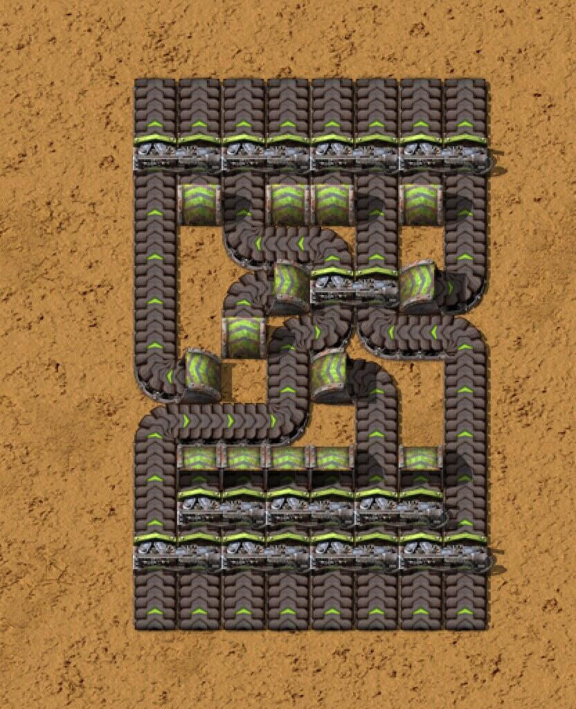</a> 
  <i>The classic 8 → 8, turbo'd.</i>

| | |
|---|---|
| Download | **[Combined book (FactorioBin)](https://factoriobin.com/post/xuuoif)** · [`belt-balancers-turbo.book.txt`](belt-balancers-turbo.book.txt) |
| Books individually | [raynquist turbo](strings/raynquist-fall-2025-turbo.txt) · [chocpaint turbo](strings/chocpaint-v3077-turbo.txt) · [raynquist original](strings/raynquist-fall-2025-original.txt) · [chocpaint original](strings/chocpaint-v3077-original.txt) |
| Blueprints | 293 unique balancers as individual strings in [`blueprints/`](blueprints/), decoded JSON in [`json/`](json/) |
| Renders | Every balancer rendered below (Factorio 2.1.11 sprites, dirt terrain) |

---

## How much does a balancer move?

A **turbo belt** moves 60 items/s. Fully stacked (4-high, Space Age belt
stacking) it moves **240 items/s**. A balancer can only move as much as its
inputs provide — so an `N → M` balancer fed by `N` fully-stacked turbo belts
moves **N stacked belts ≈ N × 240 items/s**. For almost every design here,
just count the inputs.

## Legend (ChocPaint tags)

| Tag | Meaning |
|---|---|
| UT | Unlimited throughput — always full throughput even when starved |
| Lane | Also balances both lanes of each belt |
| Corner | Output turns 90° |
| Edge | Inputs/outputs enter on the edges |
| Inline | Flow continues in a straight line |
| Split | Splits/merges outputs |
| ⚠ Unbalanced | Not perfectly balanced — flagged by the author |
| ☢ Residual | Items may stay on belts — flagged by the author |
| `[item=turbo-transport-belt]+` | Requires turbo belts for full throughput |

---

# Catalogue

# belt balancers

Every belt balancer, sorted by number of input belts.
raynquist canonical designs first per ratio, ChocPaint compendium variants ([WxH] tags) after.

## 1 to x

| Preview | Balancer | Moves (fully stacked) | Notes |
|---|---|---|---|
| 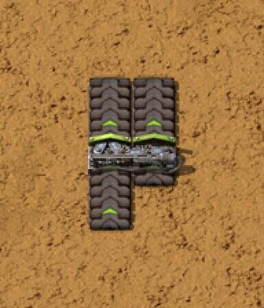 | **1-2 [2x3] (UT)** [`bp`](blueprints/chocpaint__1_to_x__1-2_2x3_UT.txt) · chocpaint | **1 → 2** 1 stacked turbo belt ≈ 240 items/s | unlimited throughput Ha ha |
| 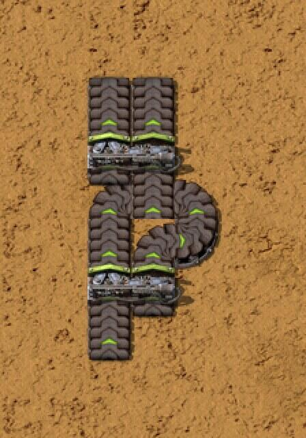 | **1-2 [3x6] (UT, Lane ⚠)** [`bp`](blueprints/chocpaint__1_to_x__1-2_3x6_UT_Lane_virtual-signal_signal-alert.txt) · chocpaint | **1 → 2** 1 stacked turbo belt ≈ 240 items/s | unlimited throughput lane-balanced ⚠ not fully balanced |
| 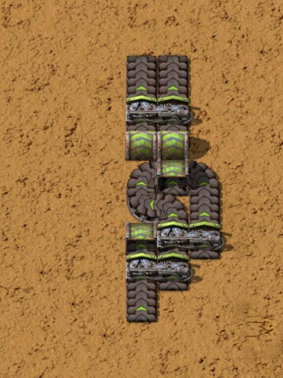 | **1-2 [3x8] (UT, Lane,  ☢)** [`bp`](blueprints/chocpaint__1_to_x__1-2_3x8_UT_Lane_virtual-signal_signal-radioactivity.txt) · chocpaint | **1 → 2** 1 stacked turbo belt ≈ 240 items/s | unlimited throughput lane-balanced ☢ residual items possible |
| 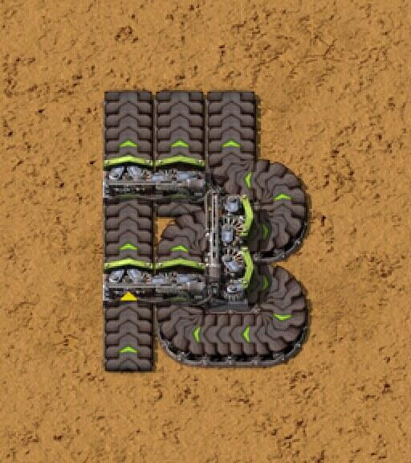 | **1-3 [4x5] TU balancer** [`bp`](blueprints/raynquist__1_to_x__1-3_4x5_TU_balancer.txt) | **1 → 3** 1 stacked turbo belt ≈ 240 items/s | Throughput-unlimited (TU) balancers always provide full throughput. Regular balancers are only guaranteed to provide full throughput when all inputs or all outputs are utilized. |
| 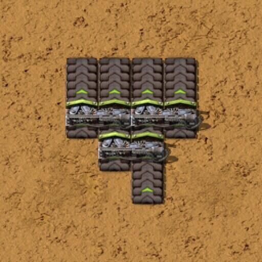 | **1-4 [4x4] TU balancer** [`bp`](blueprints/raynquist__1_to_x__1-4_4x4_TU_balancer.txt) | **1 → 4** 1 stacked turbo belt ≈ 240 items/s | Throughput-unlimited (TU) balancers always provide full throughput. Regular balancers are only guaranteed to provide full throughput when all inputs or all outputs are utilized. |
| 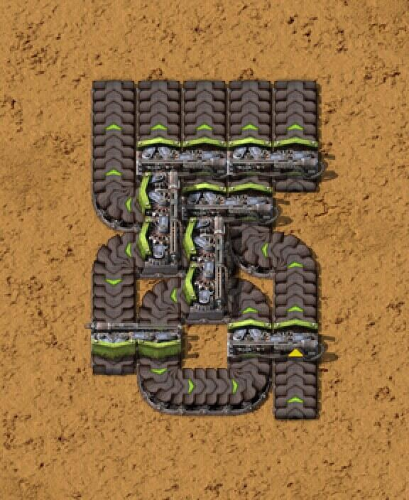 | **1-5 [5x7] TU balancer** [`bp`](blueprints/raynquist__1_to_x__1-5_5x7_TU_balancer.txt) | **1 → 5** 1 stacked turbo belt ≈ 240 items/s | Throughput-unlimited (TU) balancers always provide full throughput. Regular balancers are only guaranteed to provide full throughput when all inputs or all outputs are utilized. |
| 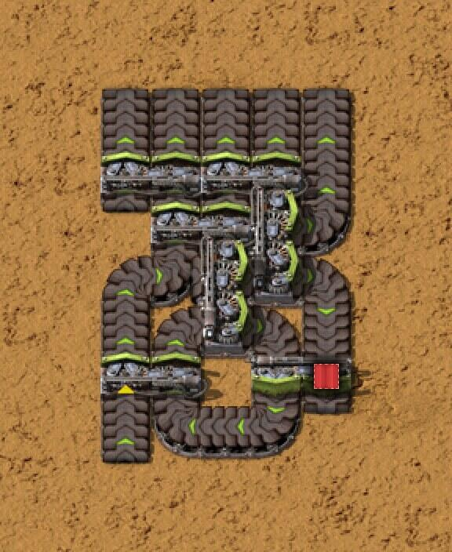 | **1-5 [5x7] (UT)** [`bp`](blueprints/chocpaint__1_to_x__1-5_5x7_UT.txt) · chocpaint | **1 → 5** 1 stacked turbo belt ≈ 240 items/s | unlimited throughput |
| 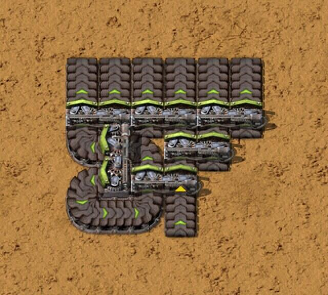 | **1-6 [6x5] TU balancer** [`bp`](blueprints/raynquist__1_to_x__1-6_6x5_TU_balancer.txt) | **1 → 6** 1 stacked turbo belt ≈ 240 items/s | Throughput-unlimited (TU) balancers always provide full throughput. Regular balancers are only guaranteed to provide full throughput when all inputs or all outputs are utilized. |
| 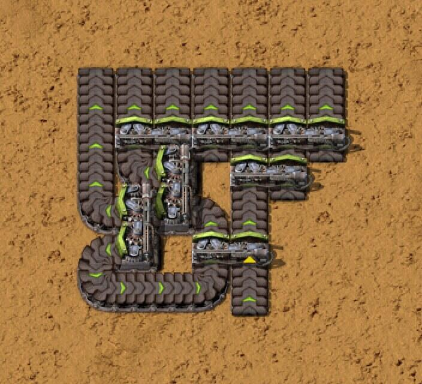 | **1-7 [7x6] TU balancer** [`bp`](blueprints/raynquist__1_to_x__1-7_7x6_TU_balancer.txt) | **1 → 7** 1 stacked turbo belt ≈ 240 items/s | Throughput-unlimited (TU) balancers always provide full throughput. Regular balancers are only guaranteed to provide full throughput when all inputs or all outputs are utilized. |
| 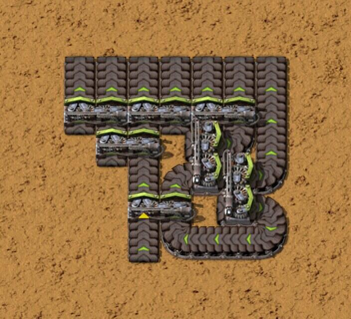 | **1-7 [7x6] (UT)** [`bp`](blueprints/chocpaint__1_to_x__1-7_7x6_UT.txt) · chocpaint | **1 → 7** 1 stacked turbo belt ≈ 240 items/s | unlimited throughput |
| 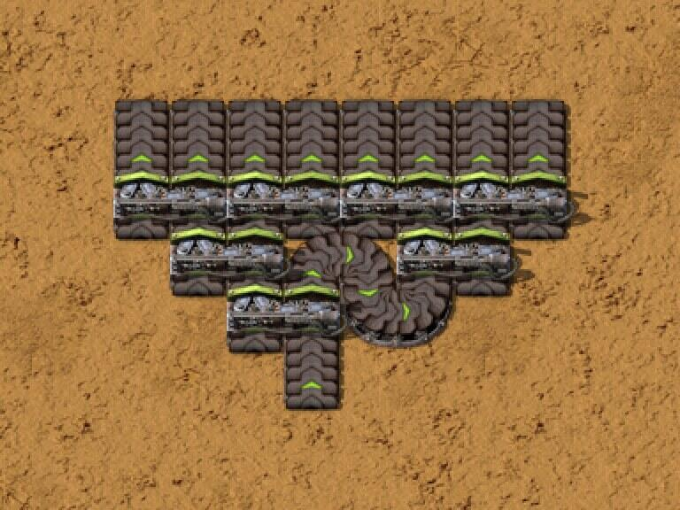 | **1-8 [8x5] TU balancer** [`bp`](blueprints/raynquist__1_to_x__1-8_8x5_TU_balancer.txt) | **1 → 8** 1 stacked turbo belt ≈ 240 items/s | Throughput-unlimited (TU) balancers always provide full throughput. Regular balancers are only guaranteed to provide full throughput when all inputs or all outputs are utilized. |
| 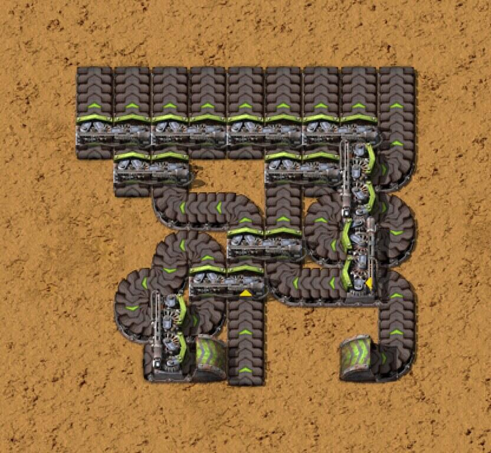 | **1-9 [9x8] TU balancer** [`bp`](blueprints/raynquist__1_to_x__1-9_9x8_TU_balancer.txt) | **1 → 9** 1 stacked turbo belt ≈ 240 items/s | Throughput-unlimited (TU) balancers always provide full throughput. Regular balancers are only guaranteed to provide full throughput when all inputs or all outputs are utilized. |
| 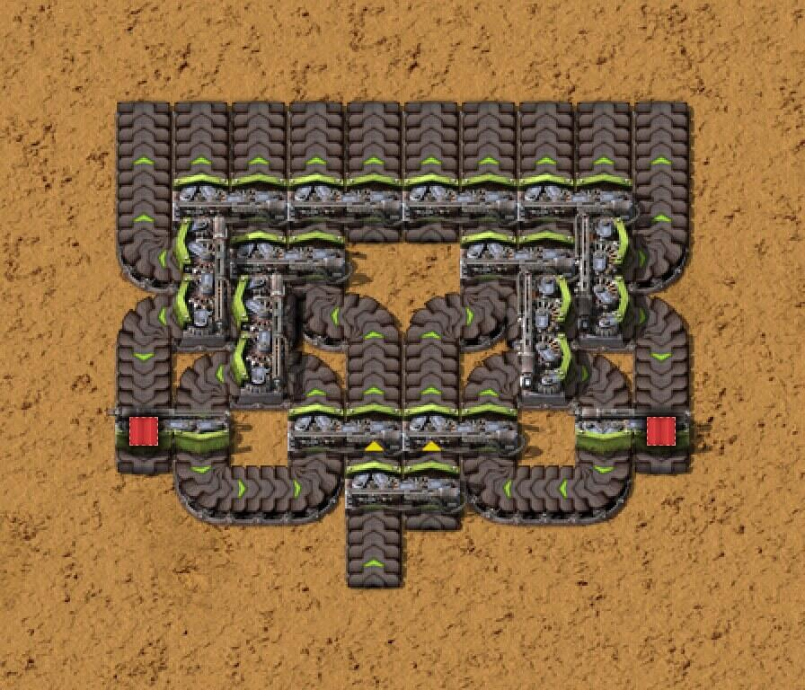 | **1-10 [10x8] (UT, Fractal)** [`bp`](blueprints/chocpaint__1_to_x__1-10_10x8_UT_Fractal.txt) · chocpaint | **1 → 10** 1 stacked turbo belt ≈ 240 items/s | unlimited throughput fractal design |
| 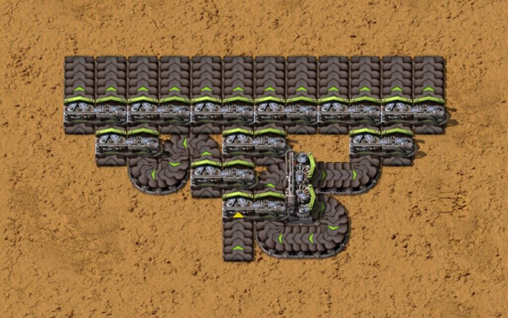 | **1-12 [12x6] (UT)** [`bp`](blueprints/chocpaint__1_to_x__1-12_12x6_UT.txt) · chocpaint | **1 → 12** 1 stacked turbo belt ≈ 240 items/s | unlimited throughput |
| 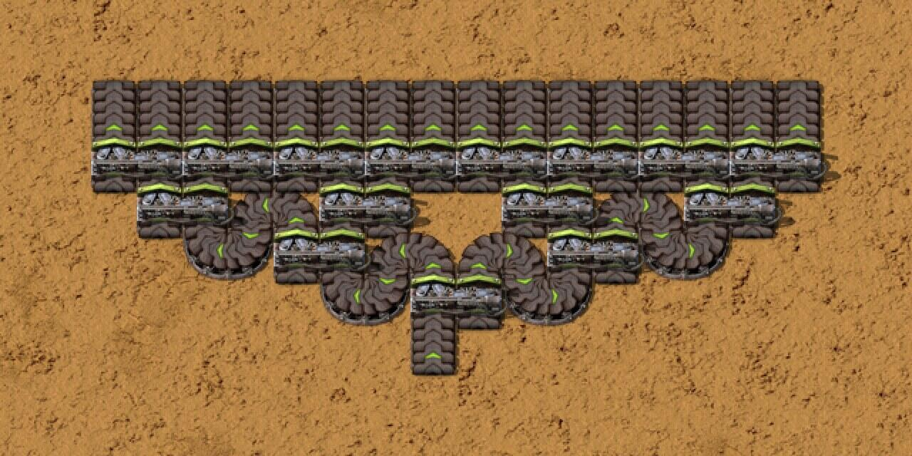 | **1-16 [16x6] (UT)** [`bp`](blueprints/chocpaint__1_to_x__1-16_16x6_UT.txt) · chocpaint | **1 → 16** 1 stacked turbo belt ≈ 240 items/s | unlimited throughput |
| 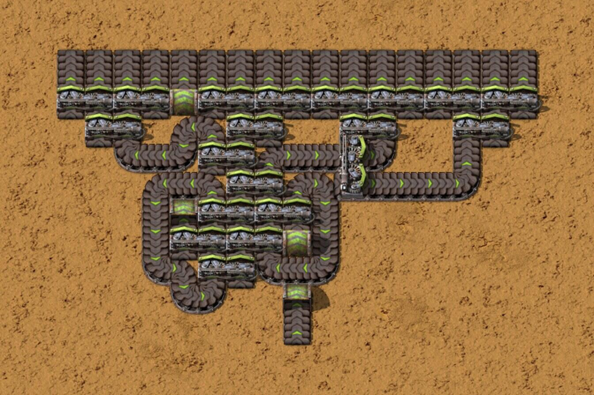 | **1-17 [17x10] balancer** [`bp`](blueprints/raynquist__1_to_x__1-17_17x10_balancer.txt) | **1 → 17** 1 stacked turbo belt ≈ 240 items/s | — |

## 2 to x

| Preview | Balancer | Moves (fully stacked) | Notes |
|---|---|---|---|
|  | **2-1 [2x4] (UT, Lane ⚠, Corner)** [`bp`](blueprints/chocpaint__2_to_x__2-1_2x4_UT_Lane_virtual-signal_signal-alert_Corner.txt) · chocpaint | **2 → 1** 2 stacked turbo belts ≈ 480 items/s | unlimited throughput lane-balanced output turns 90° ⚠ not fully balanced |
| 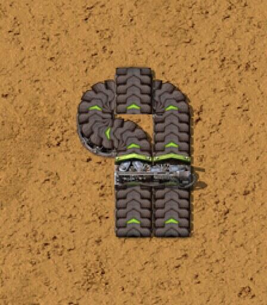 | **2-1 [3x4] (UT, Lane ⚠, Straight)** [`bp`](blueprints/chocpaint__2_to_x__2-1_3x4_UT_Lane_virtual-signal_signal-alert_Straight.txt) · chocpaint | **2 → 1** 2 stacked turbo belts ≈ 480 items/s | unlimited throughput lane-balanced straight-through ⚠ not fully balanced |
| 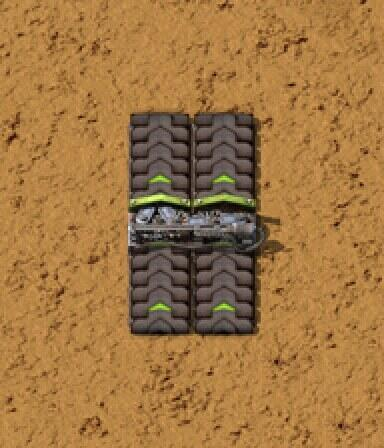 | **2-2 [2x3] (UT)** [`bp`](blueprints/chocpaint__2_to_x__2-2_2x3_UT.txt) · chocpaint | **2 → 2** 2 stacked turbo belts ≈ 480 items/s | unlimited throughput Ha ha |
| 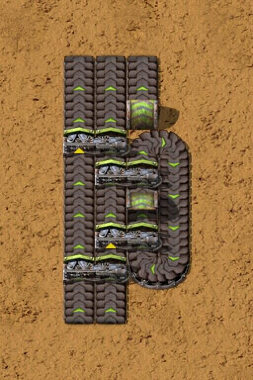 | **2-3 [4x8] TU balancer** [`bp`](blueprints/raynquist__2_to_x__2-3_4x8_TU_balancer.txt) | **2 → 3** 2 stacked turbo belts ≈ 480 items/s | Throughput-unlimited (TU) balancers always provide full throughput. Regular balancers are only guaranteed to provide full throughput when all inputs or all outputs are utilized. |
| 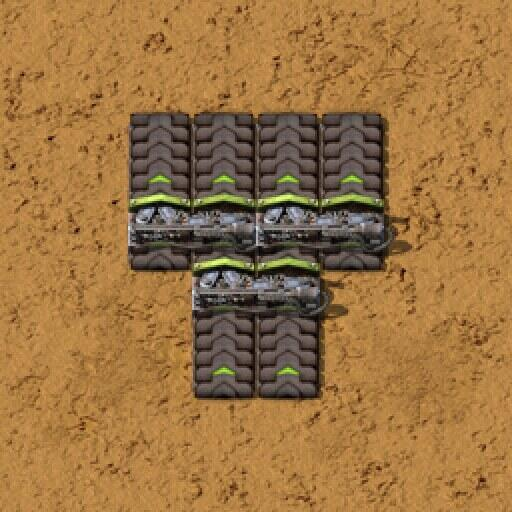 | **2-4 [4x4] balancer** [`bp`](blueprints/raynquist__2_to_x__2-4_4x4_balancer.txt) | **2 → 4** 2 stacked turbo belts ≈ 480 items/s | — |
| 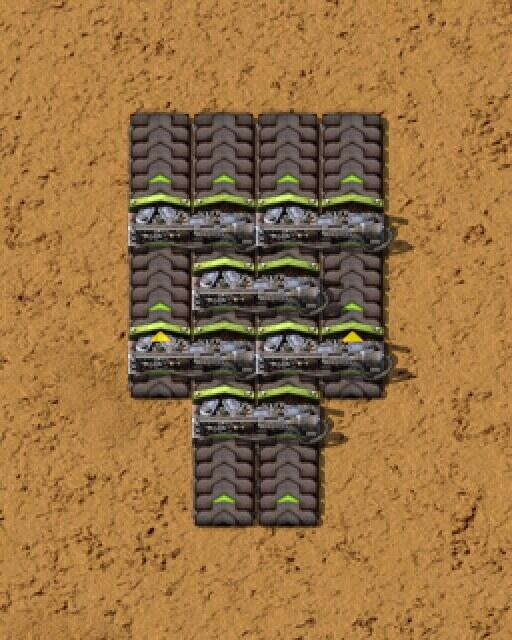 | **2-4 [4x6] TU balancer** [`bp`](blueprints/raynquist__2_to_x__2-4_4x6_TU_balancer.txt) | **2 → 4** 2 stacked turbo belts ≈ 480 items/s | Throughput-unlimited (TU) balancers always provide full throughput. Regular balancers are only guaranteed to provide full throughput when all inputs or all outputs are utilized. |
| 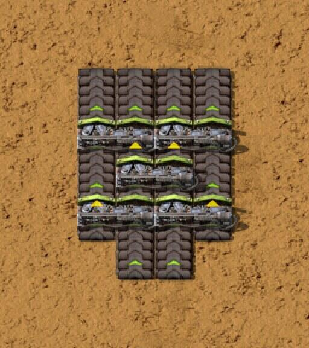 | **2-4 [4x5] (UT ⚠, Compact)** [`bp`](blueprints/chocpaint__2_to_x__2-4_4x5_UT_virtual-signal_signal-alert_Compact.txt) · chocpaint | **2 → 4** 2 stacked turbo belts ≈ 480 items/s | unlimited throughput compact ⚠ not fully balanced UT, assuming both inputs are already balanced |
| 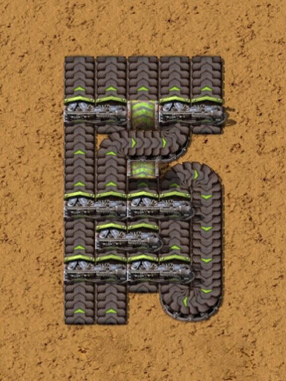 | **2-5 [5x8] balancer** [`bp`](blueprints/raynquist__2_to_x__2-5_5x8_balancer.txt) | **2 → 5** 2 stacked turbo belts ≈ 480 items/s | — |
| 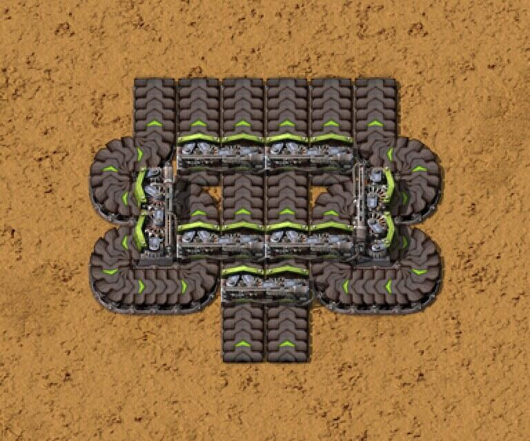 | **2-6 [8x6] balancer** [`bp`](blueprints/raynquist__2_to_x__2-6_8x6_balancer.txt) | **2 → 6** 2 stacked turbo belts ≈ 480 items/s | — |
| 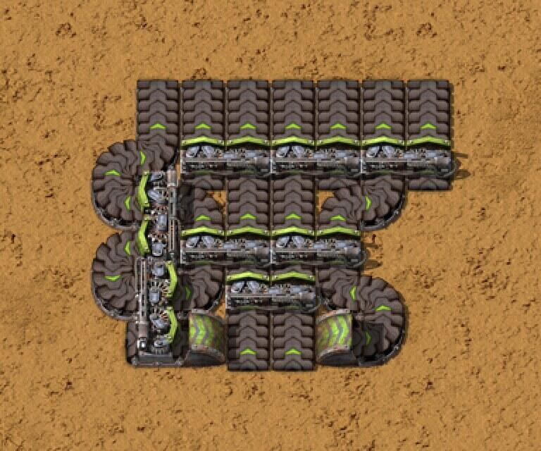 | **2-7 [8x6] balancer** [`bp`](blueprints/raynquist__2_to_x__2-7_8x6_balancer.txt) | **2 → 7** 2 stacked turbo belts ≈ 480 items/s | — |
| 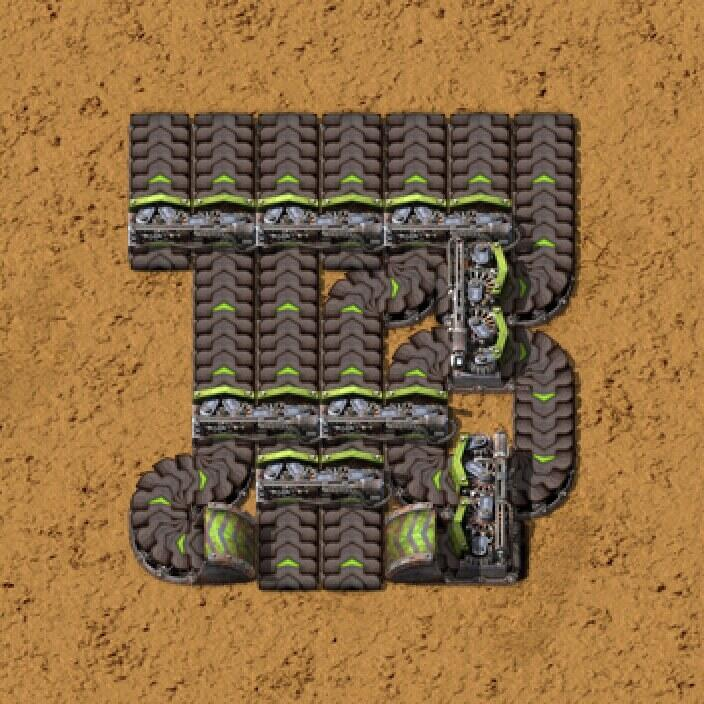 | **2-7 [7x7]** [`bp`](blueprints/chocpaint__2_to_x__2-7_7x7.txt) · chocpaint | **2 → 7** 2 stacked turbo belts ≈ 480 items/s | — |
| 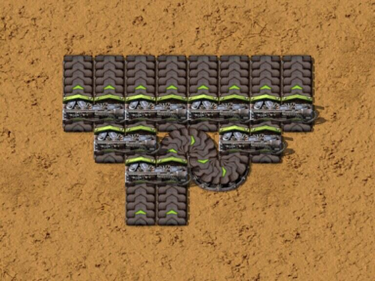 | **2-8 [8x5] balancer** [`bp`](blueprints/raynquist__2_to_x__2-8_8x5_balancer.txt) | **2 → 8** 2 stacked turbo belts ≈ 480 items/s | — |
| 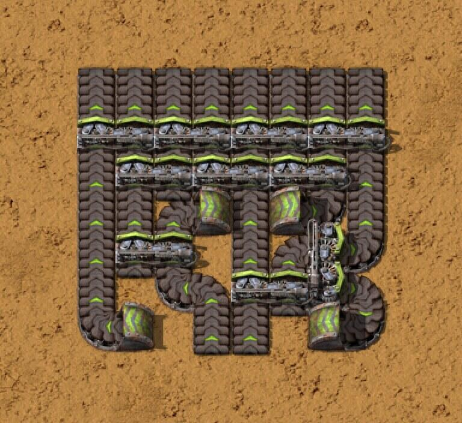 | **2-8 [8x7] TU balancer** [`bp`](blueprints/raynquist__2_to_x__2-8_8x7_TU_balancer.txt) | **2 → 8** 2 stacked turbo belts ≈ 480 items/s | Throughput-unlimited (TU) balancers always provide full throughput. Regular balancers are only guaranteed to provide full throughput when all inputs or all outputs are utilized. |
| 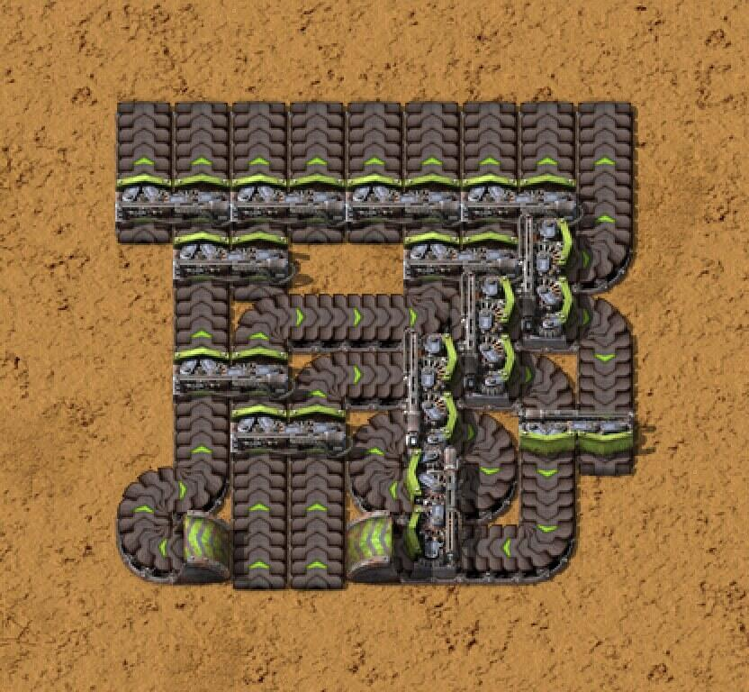 | **2-9 [9x8] balancer** [`bp`](blueprints/raynquist__2_to_x__2-9_9x8_balancer.txt) | **2 → 9** 2 stacked turbo belts ≈ 480 items/s | — |
| 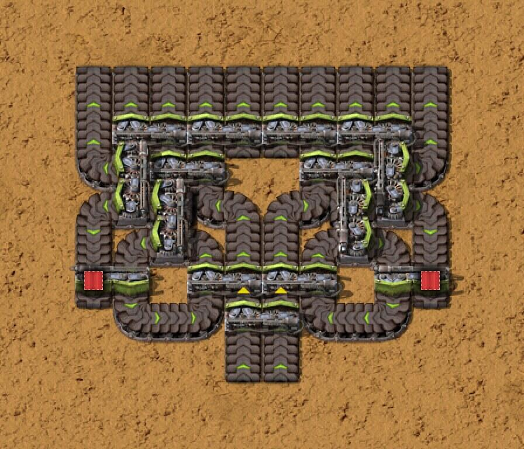 | **2-10 [10x8] (Fractal)** [`bp`](blueprints/chocpaint__2_to_x__2-10_10x8_Fractal.txt) · chocpaint | **2 → 10** 2 stacked turbo belts ≈ 480 items/s | fractal design |
| 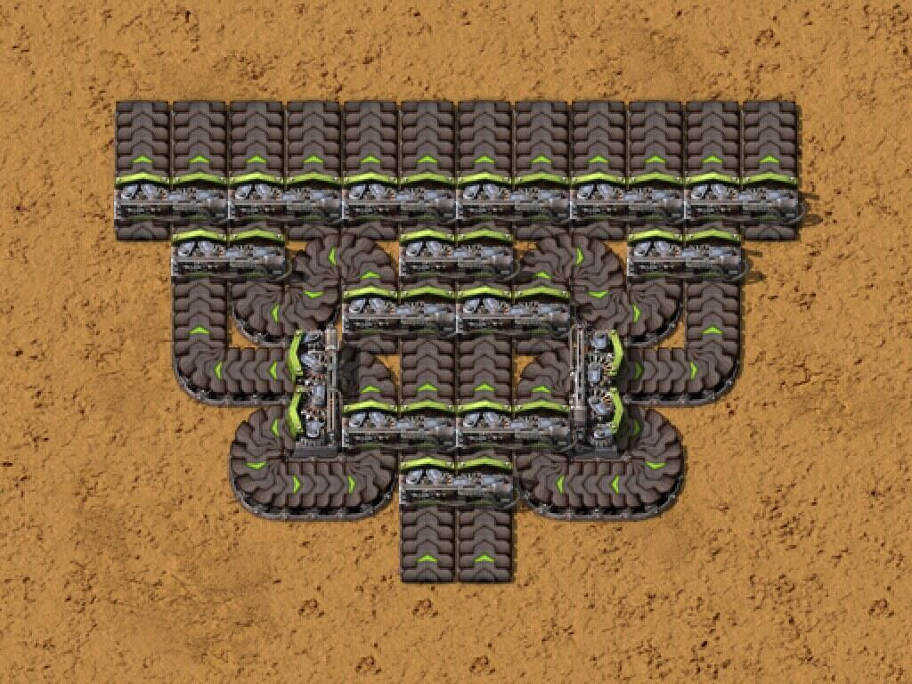 | **2-12 [12x8]** [`bp`](blueprints/chocpaint__2_to_x__2-12_12x8.txt) · chocpaint | **2 → 12** 2 stacked turbo belts ≈ 480 items/s | — |
| 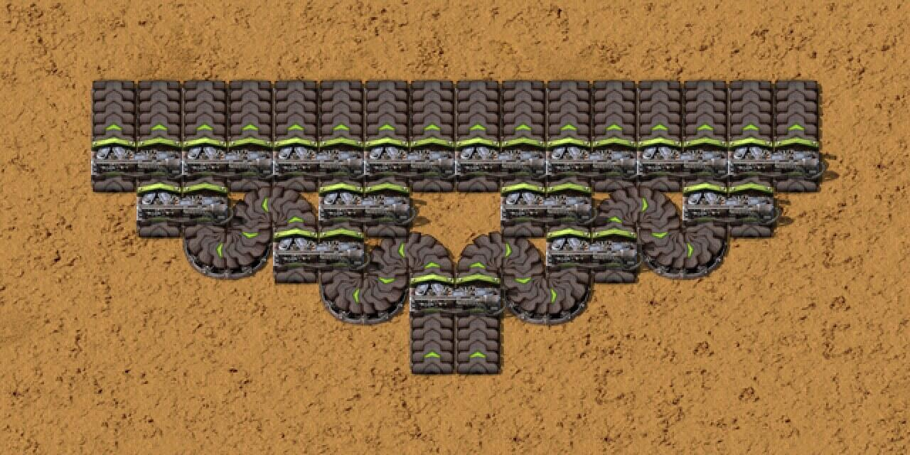 | **2-16 [16x6]** [`bp`](blueprints/chocpaint__2_to_x__2-16_16x6.txt) · chocpaint | **2 → 16** 2 stacked turbo belts ≈ 480 items/s | — |

## 3 to x

| Preview | Balancer | Moves (fully stacked) | Notes |
|---|---|---|---|
| 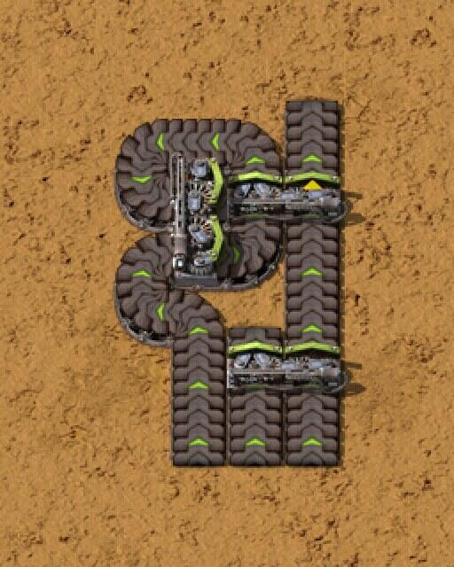 | **3-1 [4x6] TU balancer** [`bp`](blueprints/raynquist__3_to_x__3-1_4x6_TU_balancer.txt) | **3 → 1** 3 stacked turbo belts ≈ 720 items/s | Throughput-unlimited (TU) balancers always provide full throughput. Regular balancers are only guaranteed to provide full throughput when all inputs or all outputs are utilized. |
| 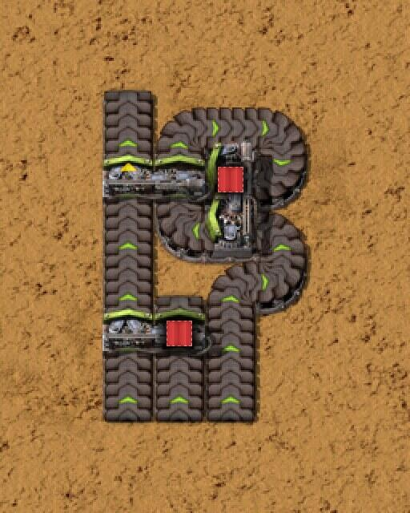 | **3-1 [4x6] (UT)** [`bp`](blueprints/chocpaint__3_to_x__3-1_4x6_UT.txt) · chocpaint | **3 → 1** 3 stacked turbo belts ≈ 720 items/s | unlimited throughput |
| 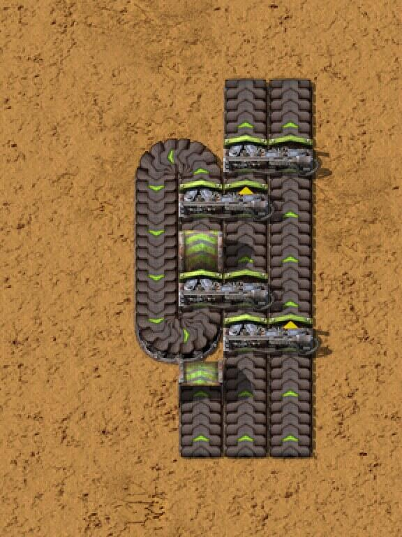 | **3-2 [4x8] TU balancer** [`bp`](blueprints/raynquist__3_to_x__3-2_4x8_TU_balancer.txt) | **3 → 2** 3 stacked turbo belts ≈ 720 items/s | Throughput-unlimited (TU) balancers always provide full throughput. Regular balancers are only guaranteed to provide full throughput when all inputs or all outputs are utilized. |
| 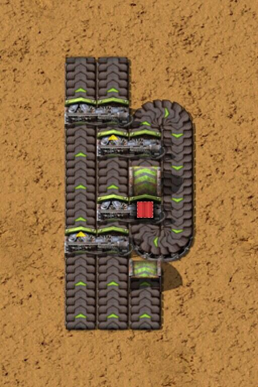 | **3-2 [4x8] (UT)** [`bp`](blueprints/chocpaint__3_to_x__3-2_4x8_UT.txt) · chocpaint | **3 → 2** 3 stacked turbo belts ≈ 720 items/s | unlimited throughput |
| 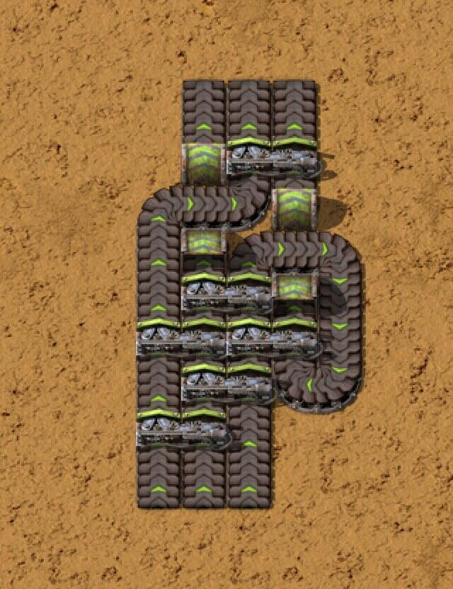 | **3-3 [5x9] TU balancer** [`bp`](blueprints/raynquist__3_to_x__3-3_5x9_TU_balancer.txt) | **3 → 3** 3 stacked turbo belts ≈ 720 items/s | Throughput-unlimited (TU) balancers always provide full throughput. Regular balancers are only guaranteed to provide full throughput when all inputs or all outputs are utilized. |
| 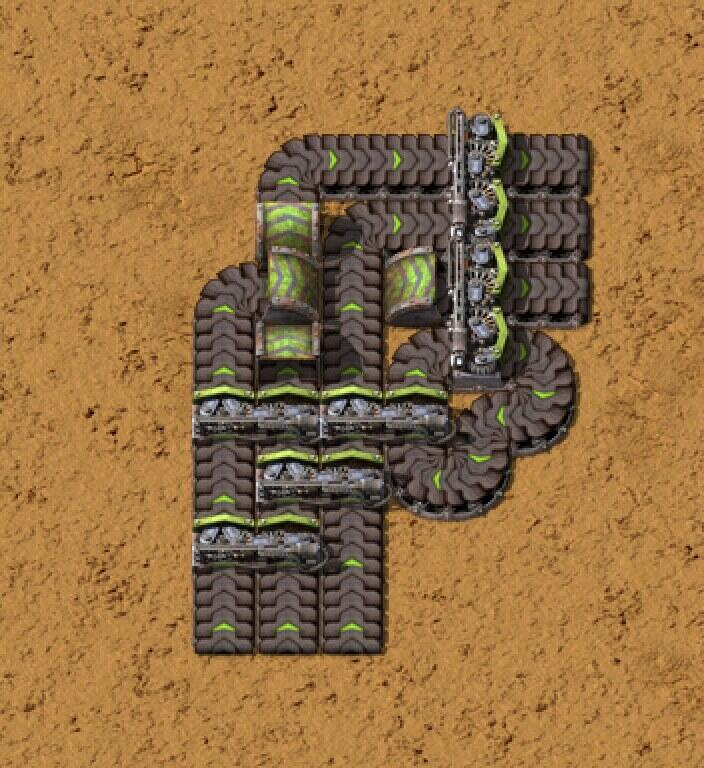 | **3-3 [6x8] TU corner balancer** [`bp`](blueprints/raynquist__3_to_x__3-3_6x8_TU_corner_balancer.txt) | **3 → 3** 3 stacked turbo belts ≈ 720 items/s | Throughput-unlimited (TU) balancers always provide full throughput. Regular balancers are only guaranteed to provide full throughput when all inputs or all outputs are utilized. |
| 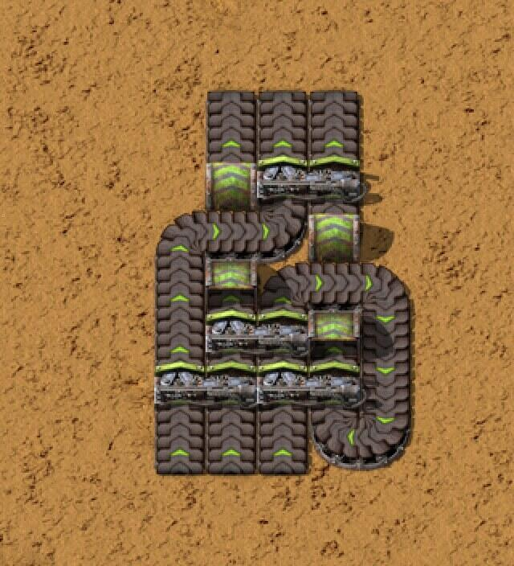 | **3-3 [5x7]** [`bp`](blueprints/chocpaint__3_to_x__3-3_5x7.txt) · chocpaint | **3 → 3** 3 stacked turbo belts ≈ 720 items/s | — |
| 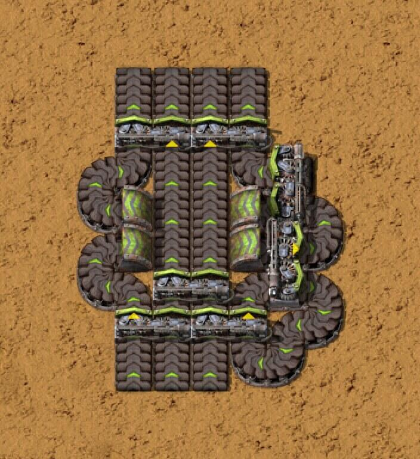 | **3-4 [7x8] TU balancer** [`bp`](blueprints/raynquist__3_to_x__3-4_7x8_TU_balancer.txt) | **3 → 4** 3 stacked turbo belts ≈ 720 items/s | Throughput-unlimited (TU) balancers always provide full throughput. Regular balancers are only guaranteed to provide full throughput when all inputs or all outputs are utilized. |
| 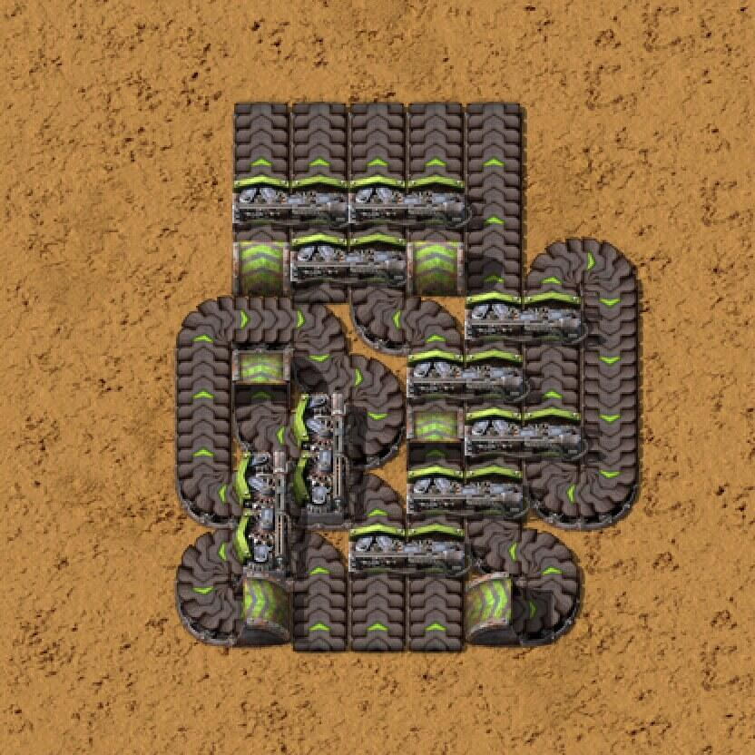 | **3-5 [8x9] balancer** [`bp`](blueprints/raynquist__3_to_x__3-5_8x9_balancer.txt) | **3 → 5** 3 stacked turbo belts ≈ 720 items/s | — |
| 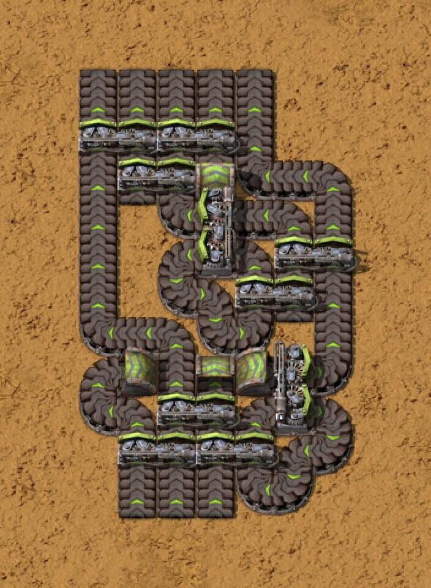 | **3-5 [7x11] (UT)** [`bp`](blueprints/chocpaint__3_to_x__3-5_7x11_UT.txt) · chocpaint | **3 → 5** 3 stacked turbo belts ≈ 720 items/s | unlimited throughput |
| 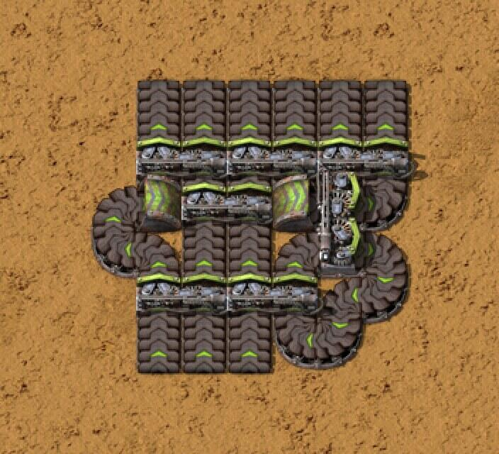 | **3-6 [7x6] balancer** [`bp`](blueprints/raynquist__3_to_x__3-6_7x6_balancer.txt) | **3 → 6** 3 stacked turbo belts ≈ 720 items/s | — |
| 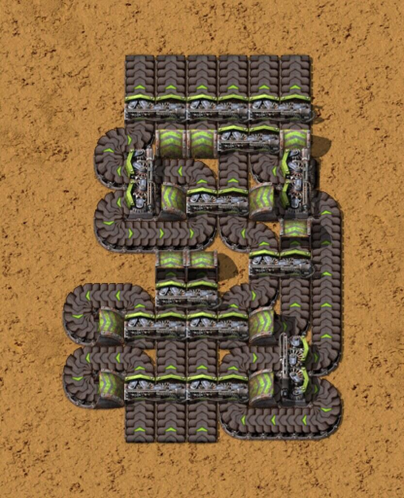 | **3-6 [9x12] TU balancer** [`bp`](blueprints/raynquist__3_to_x__3-6_9x12_TU_balancer.txt) | **3 → 6** 3 stacked turbo belts ≈ 720 items/s | Throughput-unlimited (TU) balancers always provide full throughput. Regular balancers are only guaranteed to provide full throughput when all inputs or all outputs are utilized. |
| 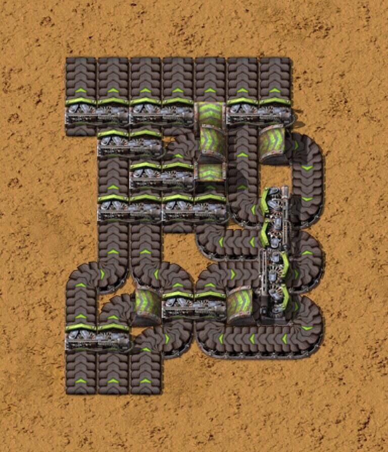 | **3-7 [8x10] balancer** [`bp`](blueprints/raynquist__3_to_x__3-7_8x10_balancer.txt) | **3 → 7** 3 stacked turbo belts ≈ 720 items/s | — |
| 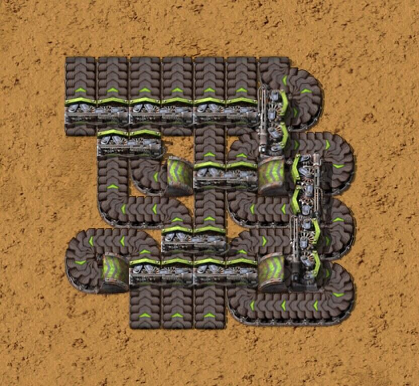 | **3-7 [9x8] (Mid)** [`bp`](blueprints/chocpaint__3_to_x__3-7_9x8_Mid.txt) · chocpaint | **3 → 7** 3 stacked turbo belts ≈ 720 items/s | — |
| 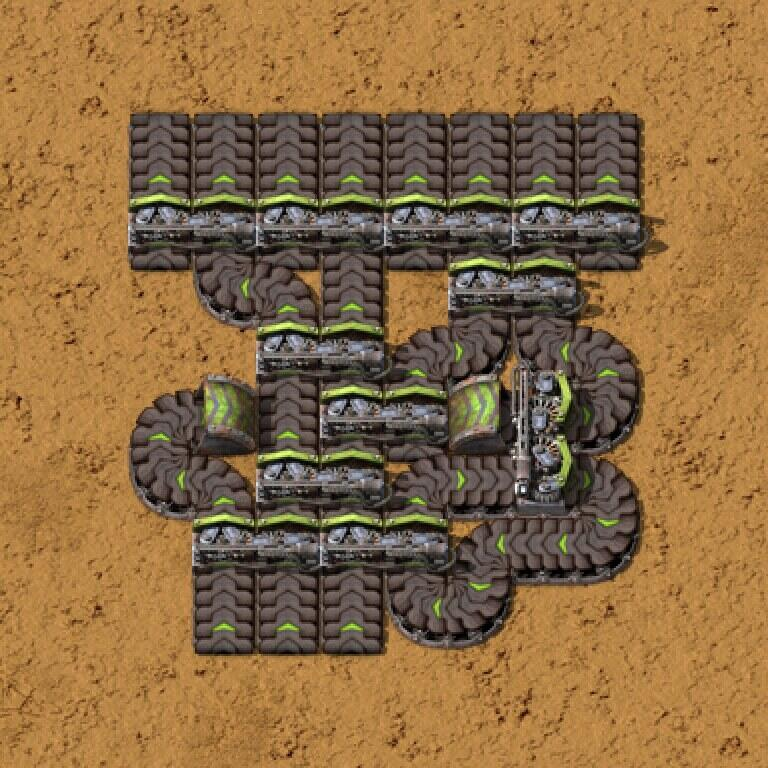 | **3-8 [8x8] balancer** [`bp`](blueprints/raynquist__3_to_x__3-8_8x8_balancer.txt) | **3 → 8** 3 stacked turbo belts ≈ 720 items/s | — |
| 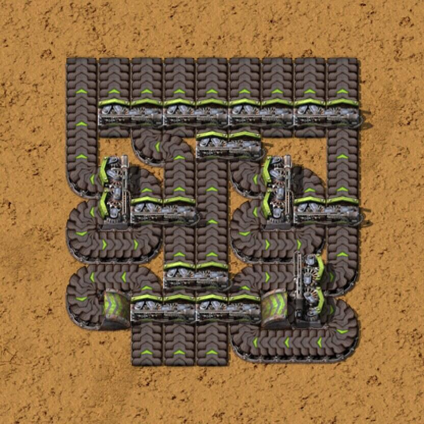 | **3-9 [9x9] balancer** [`bp`](blueprints/raynquist__3_to_x__3-9_9x9_balancer.txt) | **3 → 9** 3 stacked turbo belts ≈ 720 items/s | — |

## 4 to x

| Preview | Balancer | Moves (fully stacked) | Notes |
|---|---|---|---|
| 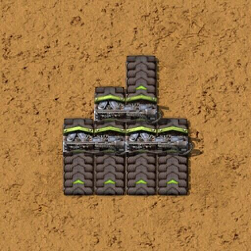 | **4-1 [4x4] TU balancer** [`bp`](blueprints/raynquist__4_to_x__4-1_4x4_TU_balancer.txt) | **4 → 1** 4 stacked turbo belts ≈ 960 items/s | Throughput-unlimited (TU) balancers always provide full throughput. Regular balancers are only guaranteed to provide full throughput when all inputs or all outputs are utilized. |
|  | **4-1 [4x5] (UT, Lane ⚠, Corner)** [`bp`](blueprints/chocpaint__4_to_x__4-1_4x5_UT_Lane_virtual-signal_signal-alert_Corner.txt) · chocpaint | **4 → 1** 4 stacked turbo belts ≈ 960 items/s | unlimited throughput lane-balanced output turns 90° ⚠ not fully balanced |
|  | **4-1 [4x6] (UT, Lane ⚠, Straight)** [`bp`](blueprints/chocpaint__4_to_x__4-1_4x6_UT_Lane_virtual-signal_signal-alert_Straight.txt) · chocpaint | **4 → 1** 4 stacked turbo belts ≈ 960 items/s | unlimited throughput lane-balanced straight-through ⚠ not fully balanced |
|  | **4-2 [4x4] balancer** [`bp`](blueprints/raynquist__4_to_x__4-2_4x4_balancer.txt) | **4 → 2** 4 stacked turbo belts ≈ 960 items/s | — |
|  | **4-2 [4x6] TU balancer** [`bp`](blueprints/raynquist__4_to_x__4-2_4x6_TU_balancer.txt) | **4 → 2** 4 stacked turbo belts ≈ 960 items/s | Throughput-unlimited (TU) balancers always provide full throughput. Regular balancers are only guaranteed to provide full throughput when all inputs or all outputs are utilized. |
|  | **4-3 [7x8] TU balancer** [`bp`](blueprints/raynquist__4_to_x__4-3_7x8_TU_balancer.txt) | **4 → 3** 4 stacked turbo belts ≈ 960 items/s | Throughput-unlimited (TU) balancers always provide full throughput. Regular balancers are only guaranteed to provide full throughput when all inputs or all outputs are utilized. |
|  | **4-3 [7x7]** [`bp`](blueprints/chocpaint__4_to_x__4-3_7x7.txt) · chocpaint | **4 → 3** 4 stacked turbo belts ≈ 960 items/s | — |
|  | **4-3 [7x8] (UT)** [`bp`](blueprints/chocpaint__4_to_x__4-3_7x8_UT.txt) · chocpaint | **4 → 3** 4 stacked turbo belts ≈ 960 items/s | unlimited throughput |
|  | **4-4 [4x10] TU balancer** [`bp`](blueprints/raynquist__4_to_x__4-4_4x10_TU_balancer.txt) | **4 → 4** 4 stacked turbo belts ≈ 960 items/s | Throughput-unlimited (TU) balancers always provide full throughput. Regular balancers are only guaranteed to provide full throughput when all inputs or all outputs are utilized. |
|  | **4-4 [6x7] TU merge balancer** [`bp`](blueprints/raynquist__4_to_x__4-4_6x7_TU_merge_balancer.txt) | **4 → 4** 4 stacked turbo belts ≈ 960 items/s | Throughput-unlimited (TU) balancers always provide full throughput. Regular balancers are only guaranteed to provide full throughput when all inputs or all outputs are utilized. |
|  | **4-4 [6x7] TU split balancer** [`bp`](blueprints/raynquist__4_to_x__4-4_6x7_TU_split_balancer.txt) | **4 → 4** 4 stacked turbo belts ≈ 960 items/s | Throughput-unlimited (TU) balancers always provide full throughput. Regular balancers are only guaranteed to provide full throughput when all inputs or all outputs are utilized. |
|  | **4-4 [7x8] TU corner balancer** [`bp`](blueprints/raynquist__4_to_x__4-4_7x8_TU_corner_balancer.txt) | **4 → 4** 4 stacked turbo belts ≈ 960 items/s | Throughput-unlimited (TU) balancers always provide full throughput. Regular balancers are only guaranteed to provide full throughput when all inputs or all outputs are utilized. |
|  | **4-4 [4x10] (UT)** [`bp`](blueprints/chocpaint__4_to_x__4-4_4x10_UT.txt) · chocpaint | **4 → 4** 4 stacked turbo belts ≈ 960 items/s | unlimited throughput |
|  | **4-4 [7x7] (UT, Corner, Compact-Tall)** [`bp`](blueprints/chocpaint__4_to_x__4-4_7x7_UT_Corner_Compact-Tall.txt) · chocpaint | **4 → 4** 4 stacked turbo belts ≈ 960 items/s | unlimited throughput output turns 90° |
|  | **4-4 [9x6] (UT, Corner, Compact-Wide)** [`bp`](blueprints/chocpaint__4_to_x__4-4_9x6_UT_Corner_Compact-Wide.txt) · chocpaint | **4 → 4** 4 stacked turbo belts ≈ 960 items/s | unlimited throughput output turns 90° |
|  | **4-5 [8x10] balancer** [`bp`](blueprints/raynquist__4_to_x__4-5_8x10_balancer.txt) | **4 → 5** 4 stacked turbo belts ≈ 960 items/s | — |
|  | **4-5 [8x10]** [`bp`](blueprints/chocpaint__4_to_x__4-5_8x10.txt) · chocpaint | **4 → 5** 4 stacked turbo belts ≈ 960 items/s | — |
|  | **4-6 [6x11] balancer** [`bp`](blueprints/raynquist__4_to_x__4-6_6x11_balancer.txt) | **4 → 6** 4 stacked turbo belts ≈ 960 items/s | — |
|  | **4-6 [8x12] TU balancer** [`bp`](blueprints/raynquist__4_to_x__4-6_8x12_TU_balancer.txt) | **4 → 6** 4 stacked turbo belts ≈ 960 items/s | Throughput-unlimited (TU) balancers always provide full throughput. Regular balancers are only guaranteed to provide full throughput when all inputs or all outputs are utilized. |
|  | **4-6 [8x12] (UT)** [`bp`](blueprints/chocpaint__4_to_x__4-6_8x12_UT.txt) · chocpaint | **4 → 6** 4 stacked turbo belts ≈ 960 items/s | unlimited throughput |
|  | **4-7 [9x9] balancer** [`bp`](blueprints/raynquist__4_to_x__4-7_9x9_balancer.txt) | **4 → 7** 4 stacked turbo belts ≈ 960 items/s | — |
|  | **4-8 [8x12] TU balancer** [`bp`](blueprints/raynquist__4_to_x__4-8_8x12_TU_balancer.txt) | **4 → 8** 4 stacked turbo belts ≈ 960 items/s | Throughput-unlimited (TU) balancers always provide full throughput. Regular balancers are only guaranteed to provide full throughput when all inputs or all outputs are utilized. |
|  | **4-8 [8x6] balancer** [`bp`](blueprints/raynquist__4_to_x__4-8_8x6_balancer.txt) | **4 → 8** 4 stacked turbo belts ≈ 960 items/s | — |
|  | **4-8 [8x12] (UT)** [`bp`](blueprints/chocpaint__4_to_x__4-8_8x12_UT.txt) · chocpaint | **4 → 8** 4 stacked turbo belts ≈ 960 items/s | unlimited throughput |
|  | **4-9 [9x12] balancer** [`bp`](blueprints/raynquist__4_to_x__4-9_9x12_balancer.txt) | **4 → 9** 4 stacked turbo belts ≈ 960 items/s | — |
|  | **4-10 [10x8] (Unbalanced, Fractal)** [`bp`](blueprints/chocpaint__4_to_x__4-10_10x8_Unbalanced_Fractal.txt) · chocpaint | **4 → 10** 4 stacked turbo belts ≈ 960 items/s | not fully balanced fractal design |
|  | **4-10 [14x16] (UT)** [`bp`](blueprints/chocpaint__4_to_x__4-10_14x16_UT.txt) · chocpaint | **4 → 10** 4 stacked turbo belts ≈ 960 items/s | unlimited throughput |
|  | **4-12 [12x16] TU balancer** [`bp`](blueprints/raynquist__4_to_x__4-12_12x16_TU_balancer.txt) | **4 → 12** 4 stacked turbo belts ≈ 960 items/s | Throughput-unlimited (TU) balancers always provide full throughput. Regular balancers are only guaranteed to provide full throughput when all inputs or all outputs are utilized. |
|  | **4-12 [12x16] (UT)** [`bp`](blueprints/chocpaint__4_to_x__4-12_12x16_UT.txt) · chocpaint | **4 → 12** 4 stacked turbo belts ≈ 960 items/s | unlimited throughput |
|  | **4-16 [16x7]** [`bp`](blueprints/chocpaint__4_to_x__4-16_16x7.txt) · chocpaint | **4 → 16** 4 stacked turbo belts ≈ 960 items/s | — |

## 5 to x

| Preview | Balancer | Moves (fully stacked) | Notes |
|---|---|---|---|
|  | **5-1 [6x7] TU balancer** [`bp`](blueprints/raynquist__5_to_x__5-1_6x7_TU_balancer.txt) | **5 → 1** 5 stacked turbo belts ≈ 1,200 items/s | Throughput-unlimited (TU) balancers always provide full throughput. Regular balancers are only guaranteed to provide full throughput when all inputs or all outputs are utilized. |
|  | **5-2 [5x8] balancer** [`bp`](blueprints/raynquist__5_to_x__5-2_5x8_balancer.txt) | **5 → 2** 5 stacked turbo belts ≈ 1,200 items/s | — |
|  | **5-2 [5x8]** [`bp`](blueprints/chocpaint__5_to_x__5-2_5x8.txt) · chocpaint | **5 → 2** 5 stacked turbo belts ≈ 1,200 items/s | — |
|  | **5-3 [8x10] balancer** [`bp`](blueprints/raynquist__5_to_x__5-3_8x10_balancer.txt) | **5 → 3** 5 stacked turbo belts ≈ 1,200 items/s | — |
|  | **5-3 [8x10]** [`bp`](blueprints/chocpaint__5_to_x__5-3_8x10.txt) · chocpaint | **5 → 3** 5 stacked turbo belts ≈ 1,200 items/s | — |
|  | **5-4 [8x10] balancer** [`bp`](blueprints/raynquist__5_to_x__5-4_8x10_balancer.txt) | **5 → 4** 5 stacked turbo belts ≈ 1,200 items/s | — |
|  | **5-5 [7x12] balancer** [`bp`](blueprints/raynquist__5_to_x__5-5_7x12_balancer.txt) | **5 → 5** 5 stacked turbo belts ≈ 1,200 items/s | — |
|  | **5-5 [5x16] (Inline)** [`bp`](blueprints/chocpaint__5_to_x__5-5_5x16_Inline.txt) · chocpaint | **5 → 5** 5 stacked turbo belts ≈ 1,200 items/s | inline |
|  | **5-5 [7x12]** [`bp`](blueprints/chocpaint__5_to_x__5-5_7x12.txt) · chocpaint | **5 → 5** 5 stacked turbo belts ≈ 1,200 items/s | — |
|  | **5-6 [8x15] balancer** [`bp`](blueprints/raynquist__5_to_x__5-6_8x15_balancer.txt) | **5 → 6** 5 stacked turbo belts ≈ 1,200 items/s | — |
|  | **5-7 [9x15] balancer** [`bp`](blueprints/raynquist__5_to_x__5-7_9x15_balancer.txt) | **5 → 7** 5 stacked turbo belts ≈ 1,200 items/s | — |
|  | **5-8 [8x14] balancer** [`bp`](blueprints/raynquist__5_to_x__5-8_8x14_balancer.txt) | **5 → 8** 5 stacked turbo belts ≈ 1,200 items/s | — |
|  | **5-9 [9x18] balancer** [`bp`](blueprints/raynquist__5_to_x__5-9_9x18_balancer.txt) | **5 → 9** 5 stacked turbo belts ≈ 1,200 items/s | — |
|  | **5-9 [9x18] (turbo-belt+)** [`bp`](blueprints/chocpaint__5_to_x__5-9_9x18_item_turbo-transport-belt.txt) · chocpaint | **5 → 9** 5 stacked turbo belts ≈ 1,200 items/s | — |
|  | **5-10 [10x13] (Fractal, Unbalanced)** [`bp`](blueprints/chocpaint__5_to_x__5-10_10x13_Fractal_Unbalanced.txt) · chocpaint | **5 → 10** 5 stacked turbo belts ≈ 1,200 items/s | fractal design not fully balanced |

## 6 to x

| Preview | Balancer | Moves (fully stacked) | Notes |
|---|---|---|---|
|  | **6-1 [6x6] TU balancer** [`bp`](blueprints/raynquist__6_to_x__6-1_6x6_TU_balancer.txt) | **6 → 1** 6 stacked turbo belts ≈ 1,440 items/s | Throughput-unlimited (TU) balancers always provide full throughput. Regular balancers are only guaranteed to provide full throughput when all inputs or all outputs are utilized. |
|  | **6-1 [6x6] (UT)** [`bp`](blueprints/chocpaint__6_to_x__6-1_6x6_UT.txt) · chocpaint | **6 → 1** 6 stacked turbo belts ≈ 1,440 items/s | unlimited throughput |
|  | **6-2 [7x6] balancer** [`bp`](blueprints/raynquist__6_to_x__6-2_7x6_balancer.txt) | **6 → 2** 6 stacked turbo belts ≈ 1,440 items/s | — |
|  | **6-3 [10x12] TU balancer** [`bp`](blueprints/raynquist__6_to_x__6-3_10x12_TU_balancer.txt) | **6 → 3** 6 stacked turbo belts ≈ 1,440 items/s | Throughput-unlimited (TU) balancers always provide full throughput. Regular balancers are only guaranteed to provide full throughput when all inputs or all outputs are utilized. |
|  | **6-3 [7x6] balancer** [`bp`](blueprints/raynquist__6_to_x__6-3_7x6_balancer.txt) | **6 → 3** 6 stacked turbo belts ≈ 1,440 items/s | — |
|  | **6-3 [7x6]** [`bp`](blueprints/chocpaint__6_to_x__6-3_7x6.txt) · chocpaint | **6 → 3** 6 stacked turbo belts ≈ 1,440 items/s | — |
|  | **6-4 [6x11] balancer** [`bp`](blueprints/raynquist__6_to_x__6-4_6x11_balancer.txt) | **6 → 4** 6 stacked turbo belts ≈ 1,440 items/s | — |
|  | **6-4 [8x13] TU balancer** [`bp`](blueprints/raynquist__6_to_x__6-4_8x13_TU_balancer.txt) | **6 → 4** 6 stacked turbo belts ≈ 1,440 items/s | Throughput-unlimited (TU) balancers always provide full throughput. Regular balancers are only guaranteed to provide full throughput when all inputs or all outputs are utilized. |
|  | **6-5 [8x15] balancer** [`bp`](blueprints/raynquist__6_to_x__6-5_8x15_balancer.txt) | **6 → 5** 6 stacked turbo belts ≈ 1,440 items/s | — |
|  | **6-6 [10x10] corner balancer** [`bp`](blueprints/raynquist__6_to_x__6-6_10x10_corner_balancer.txt) | **6 → 6** 6 stacked turbo belts ≈ 1,440 items/s | — |
|  | **6-6 [6x13] balancer** [`bp`](blueprints/raynquist__6_to_x__6-6_6x13_balancer.txt) | **6 → 6** 6 stacked turbo belts ≈ 1,440 items/s | — |
|  | **6-6 [7x12] (turbo-belt+)** [`bp`](blueprints/chocpaint__6_to_x__6-6_7x12_item_turbo-transport-belt.txt) · chocpaint | **6 → 6** 6 stacked turbo belts ≈ 1,440 items/s | — |
|  | **6-7 [9x14] balancer** [`bp`](blueprints/raynquist__6_to_x__6-7_9x14_balancer.txt) | **6 → 7** 6 stacked turbo belts ≈ 1,440 items/s | — |
|  | **6-7 [9x14]** [`bp`](blueprints/chocpaint__6_to_x__6-7_9x14.txt) · chocpaint | **6 → 7** 6 stacked turbo belts ≈ 1,440 items/s | — |
|  | **6-8 [8x13] balancer** [`bp`](blueprints/raynquist__6_to_x__6-8_8x13_balancer.txt) | **6 → 8** 6 stacked turbo belts ≈ 1,440 items/s | — |
|  | **6-8 [8x13] (Mid, turbo-belt+)** [`bp`](blueprints/chocpaint__6_to_x__6-8_8x13_Mid_item_turbo-transport-belt.txt) · chocpaint | **6 → 8** 6 stacked turbo belts ≈ 1,440 items/s | — |
|  | **6-9 [9x16] balancer** [`bp`](blueprints/raynquist__6_to_x__6-9_9x16_balancer.txt) | **6 → 9** 6 stacked turbo belts ≈ 1,440 items/s | — |
|  | **6-9 [9x16] (turbo-belt+)** [`bp`](blueprints/chocpaint__6_to_x__6-9_9x16_item_turbo-transport-belt.txt) · chocpaint | **6 → 9** 6 stacked turbo belts ≈ 1,440 items/s | — |

## 7 to x

| Preview | Balancer | Moves (fully stacked) | Notes |
|---|---|---|---|
|  | **7-1 [7x6] TU balancer** [`bp`](blueprints/raynquist__7_to_x__7-1_7x6_TU_balancer.txt) | **7 → 1** 7 stacked turbo belts ≈ 1,680 items/s | Throughput-unlimited (TU) balancers always provide full throughput. Regular balancers are only guaranteed to provide full throughput when all inputs or all outputs are utilized. |
|  | **7-2 [8x6] balancer** [`bp`](blueprints/raynquist__7_to_x__7-2_8x6_balancer.txt) | **7 → 2** 7 stacked turbo belts ≈ 1,680 items/s | — |
|  | **7-2 [8x6]** [`bp`](blueprints/chocpaint__7_to_x__7-2_8x6.txt) · chocpaint | **7 → 2** 7 stacked turbo belts ≈ 1,680 items/s | — |
|  | **7-3 [9x8] balancer** [`bp`](blueprints/raynquist__7_to_x__7-3_9x8_balancer.txt) | **7 → 3** 7 stacked turbo belts ≈ 1,680 items/s | — |
|  | **7-3 [9x8]** [`bp`](blueprints/chocpaint__7_to_x__7-3_9x8.txt) · chocpaint | **7 → 3** 7 stacked turbo belts ≈ 1,680 items/s | — |
|  | **7-4 [9x9] balancer** [`bp`](blueprints/raynquist__7_to_x__7-4_9x9_balancer.txt) | **7 → 4** 7 stacked turbo belts ≈ 1,680 items/s | — |
|  | **7-5 [9x15] balancer** [`bp`](blueprints/raynquist__7_to_x__7-5_9x15_balancer.txt) | **7 → 5** 7 stacked turbo belts ≈ 1,680 items/s | — |
|  | **7-5 [9x15]** [`bp`](blueprints/chocpaint__7_to_x__7-5_9x15.txt) · chocpaint | **7 → 5** 7 stacked turbo belts ≈ 1,680 items/s | — |
|  | **7-6 [9x14] balancer** [`bp`](blueprints/raynquist__7_to_x__7-6_9x14_balancer.txt) | **7 → 6** 7 stacked turbo belts ≈ 1,680 items/s | — |
|  | **7-6 [9x14]** [`bp`](blueprints/chocpaint__7_to_x__7-6_9x14.txt) · chocpaint | **7 → 6** 7 stacked turbo belts ≈ 1,680 items/s | — |
|  | **7-7 [7x14] balancer** [`bp`](blueprints/raynquist__7_to_x__7-7_7x14_balancer.txt) | **7 → 7** 7 stacked turbo belts ≈ 1,680 items/s | — |
|  | **7-8 [8x16] balancer** [`bp`](blueprints/raynquist__7_to_x__7-8_8x16_balancer.txt) | **7 → 8** 7 stacked turbo belts ≈ 1,680 items/s | — |
|  | **7-8 [8x16] (turbo-belt+)** [`bp`](blueprints/chocpaint__7_to_x__7-8_8x16_item_turbo-transport-belt.txt) · chocpaint | **7 → 8** 7 stacked turbo belts ≈ 1,680 items/s | — |
|  | **7-8 [9x15] (turbo-belt+)** [`bp`](blueprints/chocpaint__7_to_x__7-8_9x15_item_turbo-transport-belt.txt) · chocpaint | **7 → 8** 7 stacked turbo belts ≈ 1,680 items/s | — |
|  | **7-9 [12x18] balancer** [`bp`](blueprints/raynquist__7_to_x__7-9_12x18_balancer.txt) | **7 → 9** 7 stacked turbo belts ≈ 1,680 items/s | — |
|  | **7-9 [12x18] (turbo-belt+)** [`bp`](blueprints/chocpaint__7_to_x__7-9_12x18_item_turbo-transport-belt.txt) · chocpaint | **7 → 9** 7 stacked turbo belts ≈ 1,680 items/s | — |
|  | **7-10 [10x19] balancer** [`bp`](blueprints/raynquist__7_to_x__7-10_10x19_balancer.txt) | **7 → 10** 7 stacked turbo belts ≈ 1,680 items/s | — |
|  | **7-13 [15x15] balancer** [`bp`](blueprints/raynquist__7_to_x__7-13_15x15_balancer.txt) | **7 → 13** 7 stacked turbo belts ≈ 1,680 items/s | — |

## 8 to x

| Preview | Balancer | Moves (fully stacked) | Notes |
|---|---|---|---|
|  | **8-1 [8x6] TU balancer** [`bp`](blueprints/raynquist__8_to_x__8-1_8x6_TU_balancer.txt) | **8 → 1** 8 stacked turbo belts ≈ 1,920 items/s | Throughput-unlimited (TU) balancers always provide full throughput. Regular balancers are only guaranteed to provide full throughput when all inputs or all outputs are utilized. |
|  | **8-1 [8x6] (UT, Lane ⚠)** [`bp`](blueprints/chocpaint__8_to_x__8-1_8x6_UT_Lane_virtual-signal_signal-alert.txt) · chocpaint | **8 → 1** 8 stacked turbo belts ≈ 1,920 items/s | unlimited throughput lane-balanced ⚠ not fully balanced |
|  | **8-2 [8x6] balancer** [`bp`](blueprints/raynquist__8_to_x__8-2_8x6_balancer.txt) | **8 → 2** 8 stacked turbo belts ≈ 1,920 items/s | — |
|  | **8-2 [8x8] TU balancer** [`bp`](blueprints/raynquist__8_to_x__8-2_8x8_TU_balancer.txt) | **8 → 2** 8 stacked turbo belts ≈ 1,920 items/s | Throughput-unlimited (TU) balancers always provide full throughput. Regular balancers are only guaranteed to provide full throughput when all inputs or all outputs are utilized. |
|  | **8-2 [8x6] (Lane ⚠)** [`bp`](blueprints/chocpaint__8_to_x__8-2_8x6_Lane_virtual-signal_signal-alert.txt) · chocpaint | **8 → 2** 8 stacked turbo belts ≈ 1,920 items/s | lane-balanced ⚠ not fully balanced |
|  | **8-3 [8x9] balancer** [`bp`](blueprints/raynquist__8_to_x__8-3_8x9_balancer.txt) | **8 → 3** 8 stacked turbo belts ≈ 1,920 items/s | — |
|  | **8-3 [8x9]** [`bp`](blueprints/chocpaint__8_to_x__8-3_8x9.txt) · chocpaint | **8 → 3** 8 stacked turbo belts ≈ 1,920 items/s | — |
|  | **8-4 [8x12] TU balancer** [`bp`](blueprints/raynquist__8_to_x__8-4_8x12_TU_balancer.txt) | **8 → 4** 8 stacked turbo belts ≈ 1,920 items/s | Throughput-unlimited (TU) balancers always provide full throughput. Regular balancers are only guaranteed to provide full throughput when all inputs or all outputs are utilized. |
|  | **8-4 [8x7] balancer** [`bp`](blueprints/raynquist__8_to_x__8-4_8x7_balancer.txt) | **8 → 4** 8 stacked turbo belts ≈ 1,920 items/s | — |
|  | **8-5 [8x14] balancer** [`bp`](blueprints/raynquist__8_to_x__8-5_8x14_balancer.txt) | **8 → 5** 8 stacked turbo belts ≈ 1,920 items/s | — |
|  | **8-5 [8x14]** [`bp`](blueprints/chocpaint__8_to_x__8-5_8x14.txt) · chocpaint | **8 → 5** 8 stacked turbo belts ≈ 1,920 items/s | — |
|  | **8-5 [8x15] (turbo-belt+)** [`bp`](blueprints/chocpaint__8_to_x__8-5_8x15_item_turbo-transport-belt.txt) · chocpaint | **8 → 5** 8 stacked turbo belts ≈ 1,920 items/s | — |
|  | **8-6 [8x13] balancer** [`bp`](blueprints/raynquist__8_to_x__8-6_8x13_balancer.txt) | **8 → 6** 8 stacked turbo belts ≈ 1,920 items/s | — |
|  | **8-6 [8x13]** [`bp`](blueprints/chocpaint__8_to_x__8-6_8x13.txt) · chocpaint | **8 → 6** 8 stacked turbo belts ≈ 1,920 items/s | — |
|  | **8-7 [8x16] balancer** [`bp`](blueprints/raynquist__8_to_x__8-7_8x16_balancer.txt) | **8 → 7** 8 stacked turbo belts ≈ 1,920 items/s | — |
|  | **8-8 [10x11] corner balancer** [`bp`](blueprints/raynquist__8_to_x__8-8_10x11_corner_balancer.txt) | **8 → 8** 8 stacked turbo belts ≈ 1,920 items/s | — |
|  | **8-8 [13x9] merge balancer** [`bp`](blueprints/raynquist__8_to_x__8-8_13x9_merge_balancer.txt) | **8 → 8** 8 stacked turbo belts ≈ 1,920 items/s | — |
|  | **8-8 [13x9] split balancer** [`bp`](blueprints/raynquist__8_to_x__8-8_13x9_split_balancer.txt) | **8 → 8** 8 stacked turbo belts ≈ 1,920 items/s | — |
|  | **8-8 [8x12] balancer** [`bp`](blueprints/raynquist__8_to_x__8-8_8x12_balancer.txt) | **8 → 8** 8 stacked turbo belts ≈ 1,920 items/s | — |
|  | **8-8 [8x18] TU balancer** [`bp`](blueprints/raynquist__8_to_x__8-8_8x18_TU_balancer.txt) | **8 → 8** 8 stacked turbo belts ≈ 1,920 items/s | Throughput-unlimited (TU) balancers always provide full throughput. Regular balancers are only guaranteed to provide full throughput when all inputs or all outputs are utilized. |
|  | **8-8 [10x17] (UT, Split-2, turbo-belt+)** [`bp`](blueprints/chocpaint__8_to_x__8-8_10x17_UT_Split-2_item_turbo-transport-belt.txt) · chocpaint | **8 → 8** 8 stacked turbo belts ≈ 1,920 items/s | unlimited throughput |
|  | **8-8 [11x9] (Split-2)** [`bp`](blueprints/chocpaint__8_to_x__8-8_11x9_Split-2.txt) · chocpaint | **8 → 8** 8 stacked turbo belts ≈ 1,920 items/s | — |
|  | **8-8 [12x10] (Split-4)** [`bp`](blueprints/chocpaint__8_to_x__8-8_12x10_Split-4.txt) · chocpaint | **8 → 8** 8 stacked turbo belts ≈ 1,920 items/s | — |
|  | **8-8 [13x9] (Edge-In)** [`bp`](blueprints/chocpaint__8_to_x__8-8_13x9_Edge-In.txt) · chocpaint | **8 → 8** 8 stacked turbo belts ≈ 1,920 items/s | — |
|  | **8-8 [8x17] (Fractal)** [`bp`](blueprints/chocpaint__8_to_x__8-8_8x17_Fractal.txt) · chocpaint | **8 → 8** 8 stacked turbo belts ≈ 1,920 items/s | fractal design |
|  | **8-8 [8x18] (UT, turbo-belt+)** [`bp`](blueprints/chocpaint__8_to_x__8-8_8x18_UT_item_turbo-transport-belt.txt) · chocpaint | **8 → 8** 8 stacked turbo belts ≈ 1,920 items/s | unlimited throughput |
|  | **8-9 [11x16] balancer** [`bp`](blueprints/raynquist__8_to_x__8-9_11x16_balancer.txt) | **8 → 9** 8 stacked turbo belts ≈ 1,920 items/s | — |
|  | **8-9 [11x16] (turbo-belt+)** [`bp`](blueprints/chocpaint__8_to_x__8-9_11x16_item_turbo-transport-belt.txt) · chocpaint | **8 → 9** 8 stacked turbo belts ≈ 1,920 items/s | — |
|  | **8-9 [9x19] (turbo-belt+)** [`bp`](blueprints/chocpaint__8_to_x__8-9_9x19_item_turbo-transport-belt.txt) · chocpaint | **8 → 9** 8 stacked turbo belts ≈ 1,920 items/s | — |
|  | **8-10 [10x16] balancer** [`bp`](blueprints/raynquist__8_to_x__8-10_10x16_balancer.txt) | **8 → 10** 8 stacked turbo belts ≈ 1,920 items/s | — |
|  | **8-10 [10x16] (turbo-belt+)** [`bp`](blueprints/chocpaint__8_to_x__8-10_10x16_item_turbo-transport-belt.txt) · chocpaint | **8 → 10** 8 stacked turbo belts ≈ 1,920 items/s | — |
|  | **8-12 [12x14] balancer** [`bp`](blueprints/raynquist__8_to_x__8-12_12x14_balancer.txt) | **8 → 12** 8 stacked turbo belts ≈ 1,920 items/s | — |
|  | **8-12 [12x14] (turbo-belt+)** [`bp`](blueprints/chocpaint__8_to_x__8-12_12x14_item_turbo-transport-belt.txt) · chocpaint | **8 → 12** 8 stacked turbo belts ≈ 1,920 items/s | — |
|  | **8-13 [15x15] balancer** [`bp`](blueprints/raynquist__8_to_x__8-13_15x15_balancer.txt) | **8 → 13** 8 stacked turbo belts ≈ 1,920 items/s | — |
|  | **8-13 [15x15] (turbo-belt+)** [`bp`](blueprints/chocpaint__8_to_x__8-13_15x15_item_turbo-transport-belt.txt) · chocpaint | **8 → 13** 8 stacked turbo belts ≈ 1,920 items/s | — |
|  | **8-16 [16x10]** [`bp`](blueprints/chocpaint__8_to_x__8-16_16x10.txt) · chocpaint | **8 → 16** 8 stacked turbo belts ≈ 1,920 items/s | — |

## 9 to x

| Preview | Balancer | Moves (fully stacked) | Notes |
|---|---|---|---|
|  | **9-1 [9x8] TU balancer** [`bp`](blueprints/raynquist__9_to_x__9-1_9x8_TU_balancer.txt) | **9 → 1** 9 stacked turbo belts ≈ 2,160 items/s | Throughput-unlimited (TU) balancers always provide full throughput. Regular balancers are only guaranteed to provide full throughput when all inputs or all outputs are utilized. |
|  | **9-2 [10x8] balancer** [`bp`](blueprints/raynquist__9_to_x__9-2_10x8_balancer.txt) | **9 → 2** 9 stacked turbo belts ≈ 2,160 items/s | — |
|  | **9-2 [10x8]** [`bp`](blueprints/chocpaint__9_to_x__9-2_10x8.txt) · chocpaint | **9 → 2** 9 stacked turbo belts ≈ 2,160 items/s | — |
|  | **9-3 [10x9] balancer** [`bp`](blueprints/raynquist__9_to_x__9-3_10x9_balancer.txt) | **9 → 3** 9 stacked turbo belts ≈ 2,160 items/s | — |
|  | **9-3 [10x9]** [`bp`](blueprints/chocpaint__9_to_x__9-3_10x9.txt) · chocpaint | **9 → 3** 9 stacked turbo belts ≈ 2,160 items/s | — |
|  | **9-4 [9x12] balancer** [`bp`](blueprints/raynquist__9_to_x__9-4_9x12_balancer.txt) | **9 → 4** 9 stacked turbo belts ≈ 2,160 items/s | — |
|  | **9-4 [9x12]** [`bp`](blueprints/chocpaint__9_to_x__9-4_9x12.txt) · chocpaint | **9 → 4** 9 stacked turbo belts ≈ 2,160 items/s | — |
|  | **9-5 [9x18] balancer** [`bp`](blueprints/raynquist__9_to_x__9-5_9x18_balancer.txt) | **9 → 5** 9 stacked turbo belts ≈ 2,160 items/s | — |
|  | **9-6 [9x16] balancer** [`bp`](blueprints/raynquist__9_to_x__9-6_9x16_balancer.txt) | **9 → 6** 9 stacked turbo belts ≈ 2,160 items/s | — |
|  | **9-6 [9x16] (turbo-belt+)** [`bp`](blueprints/chocpaint__9_to_x__9-6_9x16_item_turbo-transport-belt.txt) · chocpaint | **9 → 6** 9 stacked turbo belts ≈ 2,160 items/s | — |
|  | **9-7 [12x18] balancer** [`bp`](blueprints/raynquist__9_to_x__9-7_12x18_balancer.txt) | **9 → 7** 9 stacked turbo belts ≈ 2,160 items/s | — |
|  | **9-8 [11x16] balancer** [`bp`](blueprints/raynquist__9_to_x__9-8_11x16_balancer.txt) | **9 → 8** 9 stacked turbo belts ≈ 2,160 items/s | — |
|  | **9-9 [11x16] balancer** [`bp`](blueprints/raynquist__9_to_x__9-9_11x16_balancer.txt) | **9 → 9** 9 stacked turbo belts ≈ 2,160 items/s | — |
|  | **9-10 [11x23] balancer** [`bp`](blueprints/raynquist__9_to_x__9-10_11x23_balancer.txt) | **9 → 10** 9 stacked turbo belts ≈ 2,160 items/s | — |
|  | **9-12 [12x18] balancer** [`bp`](blueprints/raynquist__9_to_x__9-12_12x18_balancer.txt) | **9 → 12** 9 stacked turbo belts ≈ 2,160 items/s | — |
|  | **9-12 [12x18]** [`bp`](blueprints/chocpaint__9_to_x__9-12_12x18.txt) · chocpaint | **9 → 12** 9 stacked turbo belts ≈ 2,160 items/s | — |

## 10 to x

| Preview | Balancer | Moves (fully stacked) | Notes |
|---|---|---|---|
|  | **10-8 [10x16] balancer** [`bp`](blueprints/raynquist__10_to_x__10-8_10x16_balancer.txt) | **10 → 8** 10 stacked turbo belts ≈ 2,400 items/s | — |
|  | **10-10 [11x17] balancer** [`bp`](blueprints/raynquist__10_to_x__10-10_11x17_balancer.txt) | **10 → 10** 10 stacked turbo belts ≈ 2,400 items/s | — |
|  | **10-10 [11x17] (turbo-belt+)** [`bp`](blueprints/chocpaint__10_to_x__10-10_11x17_item_turbo-transport-belt.txt) · chocpaint | **10 → 10** 10 stacked turbo belts ≈ 2,400 items/s | — |
|  | **10-12 [12x22] (turbo-belt+)** [`bp`](blueprints/chocpaint__10_to_x__10-12_12x22_item_turbo-transport-belt.txt) · chocpaint | **10 → 12** 10 stacked turbo belts ≈ 2,400 items/s | — |

## 11 to x

| Preview | Balancer | Moves (fully stacked) | Notes |
|---|---|---|---|
|  | **11-10 [13x23] balancer** [`bp`](blueprints/raynquist__11_to_x__11-10_13x23_balancer.txt) | **11 → 10** 11 stacked turbo belts ≈ 2,640 items/s | — |

## 12 to x

| Preview | Balancer | Moves (fully stacked) | Notes |
|---|---|---|---|
|  | **12-4 [12x16] TU balancer** [`bp`](blueprints/raynquist__12_to_x__12-4_12x16_TU_balancer.txt) | **12 → 4** 12 stacked turbo belts ≈ 2,880 items/s | Throughput-unlimited (TU) balancers always provide full throughput. Regular balancers are only guaranteed to provide full throughput when all inputs or all outputs are utilized. |
|  | **12-4 [12x16] (UT, turbo-belt+)** [`bp`](blueprints/chocpaint__12_to_x__12-4_12x16_UT_item_turbo-transport-belt.txt) · chocpaint | **12 → 4** 12 stacked turbo belts ≈ 2,880 items/s | unlimited throughput |
|  | **12-8 [12x20] (turbo-belt+)** [`bp`](blueprints/chocpaint__12_to_x__12-8_12x20_item_turbo-transport-belt.txt) · chocpaint | **12 → 8** 12 stacked turbo belts ≈ 2,880 items/s | — |
|  | **12-10 [12x22] balancer** [`bp`](blueprints/raynquist__12_to_x__12-10_12x22_balancer.txt) | **12 → 10** 12 stacked turbo belts ≈ 2,880 items/s | — |
|  | **12-10 [12x22] (turbo-belt+)** [`bp`](blueprints/chocpaint__12_to_x__12-10_12x22_item_turbo-transport-belt.txt) · chocpaint | **12 → 10** 12 stacked turbo belts ≈ 2,880 items/s | — |
|  | **12-12 [12x19] balancer** [`bp`](blueprints/raynquist__12_to_x__12-12_12x19_balancer.txt) | **12 → 12** 12 stacked turbo belts ≈ 2,880 items/s | — |
|  | **12-12 [14x17] (turbo-belt+)** [`bp`](blueprints/chocpaint__12_to_x__12-12_14x17_item_turbo-transport-belt.txt) · chocpaint | **12 → 12** 12 stacked turbo belts ≈ 2,880 items/s | — |
|  | **12-12 [22x13] (Split-3)** [`bp`](blueprints/chocpaint__12_to_x__12-12_22x13_Split-3.txt) · chocpaint | **12 → 12** 12 stacked turbo belts ≈ 2,880 items/s | — |
|  | **12-25 [25x19] balancer** [`bp`](blueprints/raynquist__12_to_x__12-25_25x19_balancer.txt) | **12 → 25** 12 stacked turbo belts ≈ 2,880 items/s | — |
|  | **12-25 [25x19] (turbo-belt+)** [`bp`](blueprints/chocpaint__12_to_x__12-25_25x19_item_turbo-transport-belt.txt) · chocpaint | **12 → 25** 12 stacked turbo belts ≈ 2,880 items/s | — |

## 15 to x

| Preview | Balancer | Moves (fully stacked) | Notes |
|---|---|---|---|
|  | **15-6 [15x13] balancer** [`bp`](blueprints/raynquist__15_to_x__15-6_15x13_balancer.txt) | **15 → 6** 15 stacked turbo belts ≈ 3,600 items/s | — |
|  | **15-10 [15x19] balancer** [`bp`](blueprints/raynquist__15_to_x__15-10_15x19_balancer.txt) | **15 → 10** 15 stacked turbo belts ≈ 3,600 items/s | — |
|  | **15-10 [15x19]** [`bp`](blueprints/chocpaint__15_to_x__15-10_15x19.txt) · chocpaint | **15 → 10** 15 stacked turbo belts ≈ 3,600 items/s | — |

## 16 to x

| Preview | Balancer | Moves (fully stacked) | Notes |
|---|---|---|---|
|  | **16-8 [16x24] TU balancer** [`bp`](blueprints/raynquist__16_to_x__16-8_16x24_TU_balancer.txt) | **16 → 8** 16 stacked turbo belts ≈ 3,840 items/s | Throughput-unlimited (TU) balancers always provide full throughput. Regular balancers are only guaranteed to provide full throughput when all inputs or all outputs are utilized. |
|  | **16-8 [16x10] (Split-2)** [`bp`](blueprints/chocpaint__16_to_x__16-8_16x10_Split-2.txt) · chocpaint | **16 → 8** 16 stacked turbo belts ≈ 3,840 items/s | — |
|  | **16-10 [16x22] balancer** [`bp`](blueprints/raynquist__16_to_x__16-10_16x22_balancer.txt) | **16 → 10** 16 stacked turbo belts ≈ 3,840 items/s | — |
|  | **16-16 [16x16] balancer** [`bp`](blueprints/raynquist__16_to_x__16-16_16x16_balancer.txt) | **16 → 16** 16 stacked turbo belts ≈ 3,840 items/s | — |
|  | **16-16 [16x28] (Fractal, turbo-belt+)** [`bp`](blueprints/chocpaint__16_to_x__16-16_16x28_Fractal_item_turbo-transport-belt.txt) · chocpaint | **16 → 16** 16 stacked turbo belts ≈ 3,840 items/s | fractal design |
|  | **16-16 [16x31] (UT, turbo-belt+)** [`bp`](blueprints/chocpaint__16_to_x__16-16_16x31_UT_item_turbo-transport-belt.txt) · chocpaint | **16 → 16** 16 stacked turbo belts ≈ 3,840 items/s | unlimited throughput |

## oversize (20-128)

Balancers with 20 or more input belts.

| Preview | Balancer | Moves (fully stacked) | Notes |
|---|---|---|---|
|  | **20-15 [20x19] balancer** [`bp`](blueprints/raynquist__oversize_20-128___20-15_20x19_balancer.txt) | **20 → 15** 20 stacked turbo belts ≈ 4,800 items/s | — |
|  | **20-15 [20x19] (turbo-belt+)** [`bp`](blueprints/chocpaint__oversize_20-128___20-15_20x19_item_turbo-transport-belt.txt) · chocpaint | **20 → 15** 20 stacked turbo belts ≈ 4,800 items/s | — |
|  | **20-20 [24x40] (turbo-belt+)** [`bp`](blueprints/chocpaint__oversize_20-128___20-20_24x40_item_turbo-transport-belt.txt) · chocpaint | **20 → 20** 20 stacked turbo belts ≈ 4,800 items/s | — |
|  | **24-24 [44x24] (Split-6, turbo-belt+)** [`bp`](blueprints/chocpaint__oversize_20-128___24-24_44x24_Split-6_item_turbo-transport-belt.txt) · chocpaint | **24 → 24** 24 stacked turbo belts ≈ 5,760 items/s | — |
|  | **24-24 [24x45] (Inline, turbo-belt+)** [`bp`](blueprints/chocpaint__oversize_20-128___24-24_24x45_Inline_item_turbo-transport-belt.txt) · chocpaint | **24 → 24** 24 stacked turbo belts ≈ 5,760 items/s | inline |
|  | **32-32 [32x27] balancer** [`bp`](blueprints/raynquist__oversize_20-128___32-32_32x27_balancer.txt) | **32 → 32** 32 stacked turbo belts ≈ 7,680 items/s | — |
|  | **32-32 [32x27] (turbo-belt+)** [`bp`](blueprints/chocpaint__oversize_20-128___32-32_32x27_item_turbo-transport-belt.txt) · chocpaint | **32 → 32** 32 stacked turbo belts ≈ 7,680 items/s | — |
|  | **32-32 [32x47] (Fractal, turbo-belt+)** [`bp`](blueprints/chocpaint__oversize_20-128___32-32_32x47_Fractal_item_turbo-transport-belt.txt) · chocpaint | **32 → 32** 32 stacked turbo belts ≈ 7,680 items/s | fractal design |
|  | **64-64 [64x48] balancer** [`bp`](blueprints/raynquist__oversize_20-128___64-64_64x48_balancer.txt) | **64 → 64** 64 stacked turbo belts ≈ 15,360 items/s | — |
|  | **64-64 [64x56] (turbo-belt+)** [`bp`](blueprints/chocpaint__oversize_20-128___64-64_64x56_item_turbo-transport-belt.txt) · chocpaint | **64 → 64** 64 stacked turbo belts ≈ 15,360 items/s | — |
|  | **128-128 [128x74] balancer** [`bp`](blueprints/raynquist__oversize_20-128___128-128_128x74_balancer.txt) | **128 → 128** 128 stacked turbo belts ≈ 30,720 items/s | — |

# lane balancers

Dedicated lane balancers: equalize the left/right lanes within belts (N in, N out).

| Preview | Balancer | Moves (fully stacked) | Notes |
|---|---|---|---|
|  | **1-1 [3x6] TU lane balancer** [`bp`](blueprints/raynquist__lane_balancers__1-1_3x6_TU_lane_balancer.txt) | **1 → 1** 1 stacked turbo belt ≈ 240 items/s | Lane balancers also balance both sides of each belt. Throughput-unlimited (TU) balancers always provide full throughput. Regular balancers are only guaranteed to provide full throughput when all inputs or all outputs are… |
|  | **1-1 [3x6] TU lane balancer (alt)** [`bp`](blueprints/raynquist__lane_balancers__1-1_3x6_TU_lane_balancer_alt.txt) | **1 → 1** 1 stacked turbo belt ≈ 240 items/s | Lane balancers also balance both sides of each belt. Throughput-unlimited (TU) balancers always provide full throughput. Regular balancers are only guaranteed to provide full throughput when all inputs or all outputs are… |
|  | **1-1 [4x4] TU lane corner balancer** [`bp`](blueprints/raynquist__lane_balancers__1-1_4x4_TU_lane_corner_balancer.txt) | **1 → 1** 1 stacked turbo belt ≈ 240 items/s | Lane balancers also balance both sides of each belt. Throughput-unlimited (TU) balancers always provide full throughput. Regular balancers are only guaranteed to provide full throughput when all inputs or all outputs are… |
|  | **1-1 [2x4] (UT, Lane ⚠, Corner)** [`bp`](blueprints/chocpaint__lane_balancers__1-1_2x4_UT_Lane_virtual-signal_signal-alert_Corner.txt) · chocpaint | **1 → 1** 1 stacked turbo belt ≈ 240 items/s | unlimited throughput lane-balanced output turns 90° ⚠ not fully balanced |
|  | **1-1 [3x4] (UT, Lane ⚠, Straight)** [`bp`](blueprints/chocpaint__lane_balancers__1-1_3x4_UT_Lane_virtual-signal_signal-alert_Straight.txt) · chocpaint | **1 → 1** 1 stacked turbo belt ≈ 240 items/s | unlimited throughput lane-balanced straight-through ⚠ not fully balanced |
|  | **2-2 [3x8] lane balancer** [`bp`](blueprints/raynquist__lane_balancers__2-2_3x8_lane_balancer.txt) | **2 → 2** 2 stacked turbo belts ≈ 480 items/s | Lane balancers also balance both sides of each belt. |
|  | **2-2 [5x5] lane corner balancer** [`bp`](blueprints/raynquist__lane_balancers__2-2_5x5_lane_corner_balancer.txt) | **2 → 2** 2 stacked turbo belts ≈ 480 items/s | Lane balancers also balance both sides of each belt. |
|  | **2-2 [2x14] (Lane, Inline,  ☢)** [`bp`](blueprints/chocpaint__lane_balancers__2-2_2x14_Lane_Inline_virtual-signal_signal-radioactivity.txt) · chocpaint | **2 → 2** 2 stacked turbo belts ≈ 480 items/s | lane-balanced inline ☢ residual items possible |
|  | **3-3 [7x9] lane balancer** [`bp`](blueprints/raynquist__lane_balancers__3-3_7x9_lane_balancer.txt) | **3 → 3** 3 stacked turbo belts ≈ 720 items/s | Lane balancers also balance both sides of each belt. |
|  | **4-4 [6x11] lane balancer (alt)** [`bp`](blueprints/raynquist__lane_balancers__4-4_6x11_lane_balancer_alt.txt) | **4 → 4** 4 stacked turbo belts ≈ 960 items/s | Lane balancers also balance both sides of each belt. |
|  | **4-4 [8x9] lane balancer** [`bp`](blueprints/raynquist__lane_balancers__4-4_8x9_lane_balancer.txt) | **4 → 4** 4 stacked turbo belts ≈ 960 items/s | Lane balancers also balance both sides of each belt. |
|  | **4-4 [9x8] lane corner balancer** [`bp`](blueprints/raynquist__lane_balancers__4-4_9x8_lane_corner_balancer.txt) | **4 → 4** 4 stacked turbo belts ≈ 960 items/s | Lane balancers also balance both sides of each belt. |
|  | **4-4 [4x15] (Lane, Inline,  ☢)** [`bp`](blueprints/chocpaint__lane_balancers__4-4_4x15_Lane_Inline_virtual-signal_signal-radioactivity.txt) · chocpaint | **4 → 4** 4 stacked turbo belts ≈ 960 items/s | lane-balanced inline ☢ residual items possible |
|  | **4-4 [6x10] (Lane, Straight,  ⚠ ☢)** [`bp`](blueprints/chocpaint__lane_balancers__4-4_6x10_Lane_Straight_virtual-signal_signal-alert_virtual-signal_signal-radioactivity.txt) · chocpaint | **4 → 4** 4 stacked turbo belts ≈ 960 items/s | lane-balanced straight-through ⚠ not fully balanced ☢ residual items possible Warning: Beware unconnected EW underground belts. |
|  | **4-4 [8x20] (UT, Lane)** [`bp`](blueprints/chocpaint__lane_balancers__4-4_8x20_UT_Lane.txt) · chocpaint | **4 → 4** 4 stacked turbo belts ≈ 960 items/s | unlimited throughput lane-balanced |
|  | **6-6 [9x15] lane balancer** [`bp`](blueprints/raynquist__lane_balancers__6-6_9x15_lane_balancer.txt) | **6 → 6** 6 stacked turbo belts ≈ 1,440 items/s | Lane balancers also balance both sides of each belt. |
|  | **6-6 [9x15] (Lane)** [`bp`](blueprints/chocpaint__lane_balancers__6-6_9x15_Lane.txt) · chocpaint | **6 → 6** 6 stacked turbo belts ≈ 1,440 items/s | lane-balanced |
|  | **8-8 [12x13] lane balancer** [`bp`](blueprints/raynquist__lane_balancers__8-8_12x13_lane_balancer.txt) | **8 → 8** 8 stacked turbo belts ≈ 1,920 items/s | Lane balancers also balance both sides of each belt. |
|  | **8-8 [16x33] (UT, Lane)** [`bp`](blueprints/chocpaint__lane_balancers__8-8_16x33_UT_Lane.txt) · chocpaint | **8 → 8** 8 stacked turbo belts ≈ 1,920 items/s | unlimited throughput lane-balanced |
|  | **16-16 [30x42] (UT, Lane)** [`bp`](blueprints/chocpaint__lane_balancers__16-16_30x42_UT_Lane.txt) · chocpaint | **16 → 16** 16 stacked turbo belts ≈ 3,840 items/s | unlimited throughput lane-balanced |

# lane splitters

Split each lane of a belt onto its own belt (e.g. 2 belts in, 4 half-lane belts out).

| Preview | Balancer | Moves (fully stacked) | Notes |
|---|---|---|---|
|  | **2+2=4 [6x8] (Edge-Slim)** [`bp`](blueprints/chocpaint__lane_splitters__2_2_4_6x8_Edge-Slim.txt) · chocpaint | **2 → 2** 2 stacked turbo belts ≈ 480 items/s | — |
|  | **2+2=4 [8x6] (Edge-Wide)** [`bp`](blueprints/chocpaint__lane_splitters__2_2_4_8x6_Edge-Wide.txt) · chocpaint | **2 → 2** 2 stacked turbo belts ≈ 480 items/s | — |
|  | **4+4=8 [10x7] (Edge)** [`bp`](blueprints/chocpaint__lane_splitters__4_4_8_10x7_Edge.txt) · chocpaint | **4 → 4** 4 stacked turbo belts ≈ 960 items/s | I/O on the edges |
|  | **4+4=8 [8x19] (Inline)** [`bp`](blueprints/chocpaint__lane_splitters__4_4_8_8x19_Inline.txt) · chocpaint | **4 → 4** 4 stacked turbo belts ≈ 960 items/s | inline |

# downgrades

*Originally cheaper yellow/red-belt variants of the designs above — upgraded to turbo like everything else here.*

| Preview | Balancer | Moves (fully stacked) | Notes |
|---|---|---|---|
|  | **4-8 TU balancer** [`bp`](blueprints/raynquist__downgrades__4-8_TU_balancer.txt) | **4 → 8** 4 stacked turbo belts ≈ 960 items/s | Throughput-unlimited (TU) balancers always provide full throughput. Regular balancers are only guaranteed to provide full throughput when all inputs or all outputs are utilized. |
|  | **5-5 balancer** [`bp`](blueprints/raynquist__downgrades__5-5_balancer.txt) | **5 → 5** 5 stacked turbo belts ≈ 1,200 items/s | — |
|  | **5-6 balancer** [`bp`](blueprints/raynquist__downgrades__5-6_balancer.txt) | **5 → 6** 5 stacked turbo belts ≈ 1,200 items/s | — |
|  | **5-7 balancer** [`bp`](blueprints/raynquist__downgrades__5-7_balancer.txt) | **5 → 7** 5 stacked turbo belts ≈ 1,200 items/s | — |
|  | **5-8 balancer** [`bp`](blueprints/raynquist__downgrades__5-8_balancer.txt) | **5 → 8** 5 stacked turbo belts ≈ 1,200 items/s | — |
|  | **6-4 TU balancer** [`bp`](blueprints/raynquist__downgrades__6-4_TU_balancer.txt) | **6 → 4** 6 stacked turbo belts ≈ 1,440 items/s | Throughput-unlimited (TU) balancers always provide full throughput. Regular balancers are only guaranteed to provide full throughput when all inputs or all outputs are utilized. |
|  | **6-5 balancer** [`bp`](blueprints/raynquist__downgrades__6-5_balancer.txt) | **6 → 5** 6 stacked turbo belts ≈ 1,440 items/s | — |
|  | **6-6 balancer** [`bp`](blueprints/raynquist__downgrades__6-6_balancer.txt) | **6 → 6** 6 stacked turbo belts ≈ 1,440 items/s | — |
|  | **6-8 balancer** [`bp`](blueprints/raynquist__downgrades__6-8_balancer.txt) | **6 → 8** 6 stacked turbo belts ≈ 1,440 items/s | — |
|  | **6-9 balancer** [`bp`](blueprints/raynquist__downgrades__6-9_balancer.txt) | **6 → 9** 6 stacked turbo belts ≈ 1,440 items/s | — |
|  | **7-5 balancer** [`bp`](blueprints/raynquist__downgrades__7-5_balancer.txt) | **7 → 5** 7 stacked turbo belts ≈ 1,680 items/s | — |
|  | **7-7 balancer** [`bp`](blueprints/raynquist__downgrades__7-7_balancer.txt) | **7 → 7** 7 stacked turbo belts ≈ 1,680 items/s | — |
|  | **7-8 balancer** [`bp`](blueprints/raynquist__downgrades__7-8_balancer.txt) | **7 → 8** 7 stacked turbo belts ≈ 1,680 items/s | — |
|  | **8-4 TU balancer** [`bp`](blueprints/raynquist__downgrades__8-4_TU_balancer.txt) | **8 → 4** 8 stacked turbo belts ≈ 1,920 items/s | Throughput-unlimited (TU) balancers always provide full throughput. Regular balancers are only guaranteed to provide full throughput when all inputs or all outputs are utilized. |
|  | **8-5 balancer** [`bp`](blueprints/raynquist__downgrades__8-5_balancer.txt) | **8 → 5** 8 stacked turbo belts ≈ 1,920 items/s | — |
|  | **8-7 balancer** [`bp`](blueprints/raynquist__downgrades__8-7_balancer.txt) | **8 → 7** 8 stacked turbo belts ≈ 1,920 items/s | — |
|  | **8-8 balancer** [`bp`](blueprints/raynquist__downgrades__8-8_balancer.txt) | **8 → 8** 8 stacked turbo belts ≈ 1,920 items/s | — |
|  | **8-8 corner balancer** [`bp`](blueprints/raynquist__downgrades__8-8_corner_balancer.txt) | **8 → 8** 8 stacked turbo belts ≈ 1,920 items/s | — |
|  | **8-8 TU balancer** [`bp`](blueprints/raynquist__downgrades__8-8_TU_balancer.txt) | **8 → 8** 8 stacked turbo belts ≈ 1,920 items/s | Throughput-unlimited (TU) balancers always provide full throughput. Regular balancers are only guaranteed to provide full throughput when all inputs or all outputs are utilized. |
|  | **9-4 balancer** [`bp`](blueprints/raynquist__downgrades__9-4_balancer.txt) | **9 → 4** 9 stacked turbo belts ≈ 2,160 items/s | — |
|  | **9-6 balancer** [`bp`](blueprints/raynquist__downgrades__9-6_balancer.txt) | **9 → 6** 9 stacked turbo belts ≈ 2,160 items/s | — |
|  | **16-16 balancer** [`bp`](blueprints/raynquist__downgrades__16-16_balancer.txt) | **16 → 16** 16 stacked turbo belts ≈ 3,840 items/s | — |

# FAQ

| Preview | Balancer | Moves (fully stacked) | Notes |
|---|---|---|---|
|  | **What's with the deconstruction planner filter?** [`bp`](blueprints/raynquist__FAQ__What_s_with_the_item_deconstruction-planner_filter.txt) | — | It's to stop the splitter from outputting on that side because it'll sideload onto the underground in front of it otherwise. Setting the filter to deconstruction planner means only deconstruction planners can output on t… |
|  | **Why does the 4-4 have two extra splitters at the end?** [`bp`](blueprints/raynquist__FAQ__Why_does_the_4-4_have_two_extra_splitters_at_the_end.txt) | — | It makes the 4-4 TU. Without them the 4-4 would still be a balancer, just not a TU one. signal 1 If you take two regular 4-4's signal 2 and combine them, you'd get a TU 4-4. signal 3 But two of the splitters are redundan… |
|  | **What does TU mean?** [`bp`](blueprints/raynquist__FAQ__What_does_TU_mean.txt) | — | Throughput-unlimited (TU) balancers always provide full throughput. Regular n-n balancers are only guaranteed to provide full throughput when all inputs or all outputs are utilized. Regular n-m balancers are only guarant… |
|  | **What does L mean?** [`bp`](blueprints/raynquist__FAQ__What_does_L_mean.txt) | — | Lane (L) balancers, in addition to balancing belts, also balance the left sides of belts with the right sides. |
|  | **Don't splitters already balance lanes?** [`bp`](blueprints/raynquist__FAQ__Don_t_splitters_already_balance_lanes.txt) | — | They do not. Splitters balance left lanes with left lanes (signal A with signal C), and right lanes with right lanes (signal B with signal D). As a result belt balancers also balance left and right lanes separately. |
|  | **Why not just use a splitter then sideload the 2 belts onto 1 belt to balance lanes?** [`bp`](blueprints/raynquist__FAQ__Why_not_just_use_a_splitter_then_sideload_the_2_belts_onto_1_belt_to_balance_lanes.txt) | — | You can use this if you just want output balancing, but if you want input balancing this does not work. Input balancing is only applicable when belts are backed up, and when belts are backed up the signal Left and signal… |
|  | **Why do the lane balancers only balance half the lanes?** [`bp`](blueprints/raynquist__FAQ__Why_do_the_lane_balancers_only_balance_half_the_lanes.txt) | — | They balances all lanes. The sideloading parts (signal 1) may resemble output lane balancers (signal 2), but because they sideload onto undergrounds instead of belts, they don't actually do any balancing. Their purpose i… |
|  | **Isn't the 2-2 lane balancer TU?** [`bp`](blueprints/raynquist__FAQ__Isn_t_the_2-2_lane_balancer_TU.txt) | — | The 2-2 lane balancer is not TU, and is not labeled as such. To make a 2-2 TU lane balancer combine two of them like usual. |
|  | **Why is the balancer not mixing the items?** [`bp`](blueprints/raynquist__FAQ__Why_is_the_balancer_not_mixing_the_items.txt) | — | This is a behavior you can observe with just a 2-2 splitter. Splitters only care about the amount of items going through them. As long as the amount of items are correct, the splitter doesn't guarantee that it'll produce… |
|  | **Why don't you take the 4-4 TU balancer and omit one input and/or output to make a smaller balancer?** [`bp`](blueprints/raynquist__FAQ__Why_don_t_you_take_the_4-4_TU_balancer_and_omit_one_input_and_or_output_to_make_a_smaller_balancer.txt) | — | While it's true that a TU balancer guarantees full throughput regardless of how the inputs and outputs are utilized, it doesn't provide a similar guarantee for balance. The balance properties of TU balancers are the same… |
|  | **Where can I find the latest version of this book?** [`bp`](blueprints/raynquist__FAQ__Where_can_I_find_the_latest_version_of_this_book.txt) | — | https://github.com/raynquist/balancer/blob/master/blueprints/balancer_book.txt |

## How do I make my own balancers?

| Preview | Balancer | Moves (fully stacked) | Notes |
|---|---|---|---|
|  | **Basic balancing theory** [`bp`](blueprints/raynquist__How_do_I_make_my_own_balancers___Basic_balancing_theory.txt) | — | see: https://www.reddit.com/gallery/jqfhlu |
|  | **Basic lane balancing theory** [`bp`](blueprints/raynquist__How_do_I_make_my_own_balancers___Basic_lane_balancing_theory.txt) | — | see: https://www.reddit.com/gallery/jyxv5w |
|  | **Basic TU balancing theory** [`bp`](blueprints/raynquist__How_do_I_make_my_own_balancers___Basic_TU_balancing_theory.txt) | — | TU balancers are typically made by taking regular versions of the balancers and using two copies of them back-to-back. Recall that regular balancers guarantee full throughput if the inputs or outputs are fully utilized. … |
|  | **Basic n-m TU balancing theory** [`bp`](blueprints/raynquist__How_do_I_make_my_own_balancers___Basic_n-m_TU_balancing_theory.txt) | — | n-m TU balancers can be made by following the same basic theory as n-n TU balancers. They're typically made by connecting a regular n-m with a regular m-m, assuming m > n. If n > m then connect a regular n-n with a regul… |
|  | **Balancer verifiers** [`bp`](blueprints/raynquist__How_do_I_make_my_own_balancers___Balancer_verifiers.txt) | — | There are programs that can verify the correctness of balancers. The ones I know of are: github.com/d4rkc0d3r/FactorioSimulation/releases github.com/tzwaan/factorio_balancers/releases github.com/alegnani/verifactory/rele… |

### Advanced techniques

| Preview | Balancer | Moves (fully stacked) | Notes |
|---|---|---|---|
|  | **Emergent sub-balancer substitution** [`bp`](blueprints/raynquist__Advanced_techniques__Emergent_sub-balancer_substitution.txt) | — | "Unintentional" sub-balancers found in balancers can be replaced with equivalent sub-balancers. signal 1 E.g. if you take two 3-3s signal 2 and combine them into a 6-6, signal 3 you may find a new 4-4 (fast splitter) ins… |
|  | **Sub-tree merge** [`bp`](blueprints/raynquist__Advanced_techniques__Sub-tree_merge.txt) | — | signal 1 1-5 is typically constructed using two loopbacks. signal 2 The two loopbacks are usually from the same branch, but they don't have to be. signal 3 If we ignore one of the splitters, signal 4 the two loopback spl… |
|  | **Loopback substitution** [`bp`](blueprints/raynquist__Advanced_techniques__Loopback_substitution.txt) | — | signal 1 E.g. Take the 1-5 from "Sub-tree merge". signal 2 Looking at the outputs, the three output splitters not only output the five outputs, but they also output one loopback. Because the loopback comes from an output… |
|  | **Equal belt substitution** [`bp`](blueprints/raynquist__Advanced_techniques__Equal_belt_substitution.txt) | — | Equivalent belts in general are interchangeable, not just inputs/outputs. signal 1 E.g. take the 1-5 from "Loopback substitution". signal 2 The three output splitters are all 1-2, so their inputs (fast transport belt) ar… |
|  | **Re-balance substitution** [`bp`](blueprints/raynquist__Advanced_techniques__Re-balance_substitution.txt) | — | signal 1 A 1-9 can be made by combining four 1-3's. signal 2 Observe that eight of the outputs come from two internal belts (fast transport belt). signal 3 So we can just use a 2-8 instead. The 2-8 doesn't function exact… |
|  | **Complete the square** [`bp`](blueprints/raynquist__Advanced_techniques__Complete_the_square.txt) | — | signal 1 E.g. take the 1-5 from "Loopback substitution". signal 2 It naturally has four unused inputs (transport belt). Think of it as being fed four belts of emptiness. So each output belt has 1/5 belt of items and 4/5 … |
|  | **Complete the square (cont.)** [`bp`](blueprints/raynquist__Advanced_techniques__Complete_the_square_cont..txt) | — | ABCDE only describes output balance, however because the 5-5 consists of entirely 2-2 splitters, if one side is balanced then the other side must also be balanced. This is also why only the 4-4 works. If you instead comb… |
|  | **Complete the rectangle** [`bp`](blueprints/raynquist__Advanced_techniques__Complete_the_rectangle.txt) | — | signal 1 From "Sub-tree merge", we have this 3:2 ratio splitter. signal 2 If we feed the empty input with a belt, then all the emptiness would be filled, and the output becomes two full belts. signal 3 The rectangle can … |
|  | **Sub-graph substitution** [`bp`](blueprints/raynquist__Advanced_techniques__Sub-graph_substitution.txt) | — | Sub-graphs don't need to be balancers to be subtituted. Any sub-graph can be subtituted with something that's equivalent in functionality. signal 1 A conventionally constructed 2-5 has a 3:2 ratio splitter (splitter, fro… |
|  | **Deferred loopback** [`bp`](blueprints/raynquist__Advanced_techniques__Deferred_loopback.txt) | — | If a TU balancer is contructed by combining two plain balancers that have top level loopbacks (a 3-3 for example), those loopbacks can instead be done after the two balancers are combined. |
|  | **Upsize then balance** [`bp`](blueprints/raynquist__Advanced_techniques__Upsize_then_balance.txt) | — | n-m TU balancers are typically made by connecting regular n-m to a regular m-m. However in some cases it may be more efficient to multiply each of the n belts until there are a total of m belts, then balance them. For TU… |
|  | **Input priority for TU 1-n** [`bp`](blueprints/raynquist__Advanced_techniques__Input_priority_for_TU_1-n.txt) | — | Intuitively one would think that 1-n balancers are all TU. However when loopbacks are involved the loopbacks can compete with inputs for throughput. This can be fixed by prioritizing the input over the loopback. Usually … |
|  | **Custom TU solutions** [`bp`](blueprints/raynquist__Advanced_techniques__Custom_TU_solutions.txt) | — | see: https://www.reddit.com/r/factorio/comments/u4nwzj/33_tu_balancer_and_new_construction_method/ https://www.reddit.com/r/factorio/comments/v20w30/new_throughput_unlimited_balancers_details_in/ |
|  | **Balancer layout generator** [`bp`](blueprints/raynquist__Advanced_techniques__Balancer_layout_generator.txt) | — | Balancer layouts can be auto-generated using Factorio-SAT. https://github.com/R-O-C-K-E-T/Factorio-SAT https://www.reddit.com/r/factorio/comments/u7zv6d/balancer_book_update_spring_2022/i5hvmxw/ |

# helpful tools

In-game upgrade/deconstruction planner helpers.

*Contains 12 upgrade/deconstruction planners (in-game tools — not rendered).*
